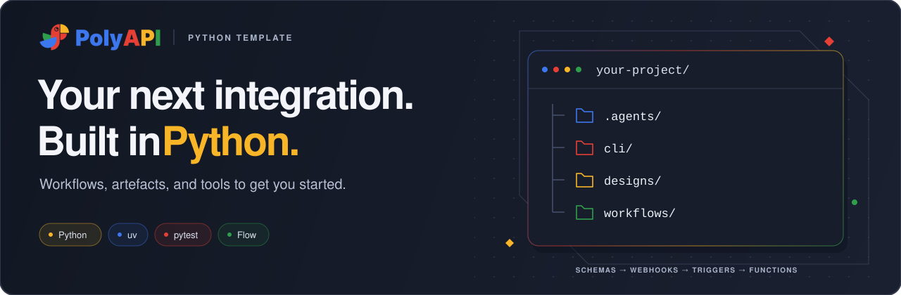

# PolyAPI Python Project Template



Build, test, and deploy PolyAPI workflows with the native Python SDK. This Python
3.12.12 workspace includes sample integrations, shared utilities, local tests,
agent guidance, and Flow tooling for managing platform resources.

New to PolyAPI? Start with the [message-of-the-day tutorial](workflows/src/sample_workflow/OVERVIEW.md),
then explore the [AI and shared utility samples](#learn-by-example). Each lesson
walks through a working integration and explains the pieces as you use them.

## Getting started

Requires [uv](https://docs.astral.sh/uv/), Git, GitHub SSH access to the template
and skills repositories, and the VS Code `code` command. Node.js and GitHub CLI
(`gh`) are not required.

```bash
git clone git@github.com:polyapi/poly-py-project-template.git && \
  ./poly-py-project-template/kickstart/kickstart.sh
```

Follow the prompts. Kickstart installs dependencies and skills, configures your
namespace and verified target, updates starter contexts, SDK references, and tutorial examples,
generates the SDK, creates `main` and `develop`,
and opens VS Code. It does not deploy resources or train the sample APIs.

Already have a checkout or need to change targets? Follow the
[guided setup](docs/SETUP.md#existing-checkout-or-manual-setup).

## Learn by example

Follow the samples in this order. Each guide includes a first run, expected
results, and exercises, with deeper reference material below the walkthrough.

| Sample | What you will learn |
| --- | --- |
| [Message of the day](workflows/src/sample_workflow/OVERVIEW.md) | Webhooks, triggers, server/client functions, trained APIs, Vari, secret injection, and a scheduled job. |
| [Weather AI](workflows/src/sample_ai_fx/OVERVIEW.md) | AI tool calls, structured weather guidance, provider configuration, and data attribution. |
| [Shared utilities](workflows/src/utilities/common/OVERVIEW.md) | Structured logging, recursive redaction, global error handling, and Slack alerts. |

The weather sample uses Open-Meteo without a weather API key; AI execution still
needs a configured provider and can incur usage charges. Follow each sample's
setup instructions before deploying or invoking it.

To build your own integration, start from the closest sample and follow the
[workflow layout and naming rules](docs/CONVENTIONS.md#workflow-layout).

## Everyday commands

Run from the project root after setup:

```bash
export ENVPATH=workflows/dev.env
make check
uv run --locked pytest workflows/src/sample_workflow/tests/test_motd.py
uv run --locked python cli/flow.py \
  push-dynamic --paths sample_workflow --dry-run
```

Export your setup-selected path once per terminal session; Python Flow resolves
it from the project root. Keep your owned namespace and verified `TARGET_ENV_ID` in the selected environment
file. Review the target and expanded deployment plan before a real push. Keep
real environment files and secrets out of Git.

Local checks need no API key and perform no deployment. Live tests require
explicit opt-in; see [verification](docs/SETUP.md#verification) and the
[sample deployment guide](workflows/src/sample_workflow/OVERVIEW.md#run-your-first-request).

## Structure

```text
.agents/skills/ bundled Python and PolyAPI agent guidance
cli/           Python Flow CLI and its regression tests
designs/       upstream specifications and starter artefacts
kickstart/     interactive project bootstrap
docs/          setup, development, and project conventions
workflows/src/ sample integrations, shared utilities, and runtime tests
```

## Further reading

| Guide | Covers |
| --- | --- |
| [Setup and development](docs/SETUP.md) | Shell helpers, manual targets, SDK pins, editor setup, local checks, and live-test opt-ins. |
| [Flow CLI](cli/README.md) | Dependency-aware deployment, API training, Canopy, subscriptions, cleanup, logs, and safeguards. |
| [Project conventions](docs/CONVENTIONS.md) | Workflow layout, naming, generated SDK usage, ownership, and tests. |
| [Agent guidance](AGENTS.md) · [Bundled skills](docs/SETUP.md#agent-skills) | Repository rules and maintained skills from [poly-skills](https://github.com/polyapi/poly-skills). |

Platform references: [PolyAPI overview](https://docs.polyapi.io/platform_overview.html)
and [Python SDK documentation](https://docs.polyapi.io/generated_sdks/python.html).
The template does not bundle customer credentials, generated environment SDKs,
or deployment automation.
