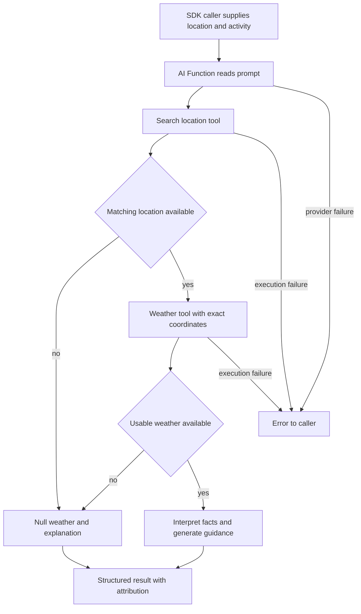

# Weather AI function

Ask for current weather and practical advice for an activity. This lesson shows
how an AI Function combines **tool-provided facts**, **fixed configuration**, and
**generated guidance** in a structured result.

Complete [Getting started](../../../README.md#getting-started) first. If you are
new to API training and the generated SDK, start with
[Message of the day](../sample_workflow/OVERVIEW.md). Run commands from the project
root in Bash.

Coding-agent skills are optional for this lesson. Kickstart installs them;
manual checkouts already include the core Python skills. See the
[skills guide](../../../docs/SETUP.md#agent-skills) for the broader collection.

## What you will learn

The function accepts a required `location` and optional `activity`. It searches
for coordinates, asks a weather API for current conditions, then generates
activity-aware guidance. The tools use Open-Meteo and need no weather account or
API key for evaluation. The AI Function still requires configured OpenAI access
and can incur provider charges.

| Part of the lesson | Purpose | Source |
| --- | --- | --- |
| Location tool | Convert a place name into candidate coordinates | [Geocoding spec](artefacts/specs/geocoding_api.json) |
| Weather tool | Fetch current conditions at the selected coordinates | [Weather spec](artefacts/specs/weather_api.json) |
| AI Function | Define inputs, prompt, allowed tools, fixed arguments, and result shape | [uplifting_weather](artefacts/ai-functions/uplifting_weather.json) |
| Contract tests | Check the local bindings and output schema | [Local tests](tests/test_weather_contract.py) |
| Runtime test | Invoke one deployed example and check its result | [Integration test](tests/test_weather_integration.py) |

## Run the lesson

### 1. Confirm the prerequisites

Use the target configured during setup and ask its administrator to confirm
OpenAI provider access and the model named in the AI artefact (`gpt-5.5`). If it
is not configured, use [provider setup](#provider-setup-reference) below before
invoking the function.

The context root must match `POLYAPI_NAMESPACE`. Kickstart updates the sample,
utilities, and copied tutorial examples to your chosen root. This copy uses
`example`. For a fresh manual checkout, run the local namespace-alignment step in
[manual setup](../../../docs/SETUP.md#configure-a-deployment-target-manually)
to update the starter code, artefacts, and examples together. Changing the
environment variable alone is insufficient. For already-customized or deployed
projects, follow [ownership and references](../../../docs/CONVENTIONS.md#ownership-and-references).

Select your setup-configured file once per terminal session:

```bash
export ENVPATH=workflows/dev.env
```

Python Flow resolves relative paths from the project root. Use the full
`workflows/dev.env` path, or the selected file if different. Direct SDK calls
below load that same file explicitly with `uv --env-file "$ENVPATH"`.

Keep the intended environment's `TARGET_ENV_ID` in that file. Kickstart and
`flow setup` save this pin; it is separate from your namespace and does not
change your login. See [target pinning](../../../docs/SETUP.md#pin-the-target-environment)
for manual setup or a mismatch.

Run the local contract checks:

```bash
uv run --locked pytest workflows/src/sample_ai_fx/tests/test_weather_contract.py
```

**Checkpoint:** these tests pass without credentials. They verify the checked-in
contracts, not the remote translator, model behavior, or weather accuracy.

### 2. Train the weather tools

Preview the bundled specifications, then train them:

```bash
uv run --locked python -m cli.operations train-openapi workflows/src/sample_ai_fx/artefacts/specs --context example.sample_ai_fx --dry-run --disable-ai
uv run --locked python -m cli.operations train-openapi workflows/src/sample_ai_fx/artefacts/specs --context example.sample_ai_fx --disable-ai
```

The preview checks local inputs only. Real training verifies the target, saves
`.poly.json` models beside the specs, registers the tools, and regenerates the
Python SDK. `--disable-ai` skips optional metadata enrichment; it does not disable
the AI Function you will invoke later.

**Checkpoint:** inspect the translated models for `searchLocations` and
`getCurrentWeather` in your namespace. Match their argument keys to the AI
artefact. In particular, the weather binding expects `temperatureUnit`, translated
from the provider's `temperature_unit`. The offline preview cannot prove that
translation. To retry saved models or deliberately regenerate them, follow
[Flow training](../../../cli/README.md#openapi-training-cleanup-and-logs).

### 3. Deploy the AI Function

If `POLY_DEPLOY_SKIP_PATHS` excludes `workflows/src/sample_ai_fx` or a parent
folder, remove that exclusion in the selected environment file first. `--paths`
does not override it. See [skipping samples](../../../docs/SETUP.md#skip-sample-deployments)
for how to keep the lesson files while excluding them from normal pushes.

```bash
uv run --locked python cli/flow.py push --paths sample_ai_fx --types ai-functions --dry-run
uv run --locked python cli/flow.py push --paths sample_ai_fx --types ai-functions
```

Review the target and plan before the real push. Flow verifies the environment
and normally regenerates the SDK afterward. This push deploys the AI contract;
training in step 2 creates its two outbound tools.

**Checkpoint:** Canopy and the generated SDK contain
`example.sample_ai_fx.uplifting_weather` under your chosen root, with `location`
and optional `activity` arguments. The function is enabled, its two tools resolve,
and the tenant's model provider is ready.

### 4. Ask for weather guidance

The following direct SDK call uses its saved connection or canonical
`POLY_API_BASE_URL` / `POLY_API_KEY` overrides from your selected file. It does
not apply Flow's aliases or `TARGET_ENV_ID` check. Confirm that the generated
bindings and connection are for the intended environment. Substitute your
namespace in the Python call if different from `example`.

```bash
uv run --locked --env-file "$ENVPATH" python - <<'PY'
import asyncio
import json
from polyapi import poly

async def main():
    result = await poly.example.sample_ai_fx.uplifting_weather_async(
        "London, United Kingdom", "an outdoor walk"
    )
    print(json.dumps(result, indent=2))

asyncio.run(main())
PY
```

An illustrative response follows. The numbers and prose are examples, not a live
weather report:

```json
{
  "location": "London, United Kingdom",
  "currentWeather": {
    "condition": "Partly cloudy",
    "temperature": 14,
    "unit": "C"
  },
  "description": "A light layer may help during your walk.",
  "recommendedItems": ["Light jacket", "Comfortable shoes"],
  "upliftingMessage": "Enjoy a change of scenery on your walk!",
  "attribution": "Weather data: Open-Meteo (https://open-meteo.com/), CC BY 4.0. Location data: GeoNames (https://www.geonames.org/). Guidance is AI-generated."
}
```

**Checkpoint:** the result follows the declared schema and includes attribution.
The location and weather fields should be grounded in tool data; the description,
items, and uplifting message are AI-generated interpretations. A valid schema
alone does not prove factual accuracy.

## How the AI contract works



In [the AI artefact](artefacts/ai-functions/uplifting_weather.json):

- `arguments` declares what callers supply. `inputTemplate` combines those inputs
  into a request; `systemPrompt` defines the behavior and failure instructions.
- `toolFunctions` limits the available tools. The AI selects search text and
  coordinates; fixed bindings select provider hosts, Celsius, and weather fields.
- `outputSchema` requires `location`, `currentWeather`, `description`,
  `recommendedItems`, `upliftingMessage`, and `attribution`, with no extra keys.
- If no location or usable weather is found, the prompt requests null weather,
  an explanation, and no recommended items. Execution errors can still propagate
  instead of producing that result; callers should handle them.

There is no webhook, server wrapper, scheduled job, or Tabi state in this sample.
The two trained tools and AI Function live in the project namespace; shared
provider configuration belongs outside its disposable resources.

Display attribution with the result. Open-Meteo weather is model-based current
estimates, not station observations, forecasts for a requested future date, or
official alerts. Its public API supports evaluation and non-commercial use;
review [the provider's terms and commercial plans](https://open-meteo.com/en/pricing)
before production use.

## Try it yourself

- Keep the location fixed and change the activity to cycling. Expect the same
  output structure and activity-specific guidance; current measurements can
  change between calls.
- Omit the second argument. The optional activity should not be necessary for a
  useful response. Confirm this behavior in your environment.
- Use an ambiguous place name, then add its country. Inspect how the resolved
  location changes and why the selected coordinates matter.
- Trace `temperatureUnit` from the weather spec through the translated model to
  its fixed binding. Changing that binding also requires aligning the prompt,
  output schema, and tests; a schema is part of the contract.
- Inspect the no-match instructions. A live exercise should check for null weather
  and empty items rather than assume the model obeyed the prompt.

## Verification and troubleshooting

After the manual call, the opt-in deployed test checks one London/outdoor-walk
response:

```bash
RUN_POLY_INTEGRATION=true RUN_AI_INTEGRATION=true uv run --locked --env-file "$ENVPATH" pytest workflows/src/sample_ai_fx/tests/test_weather_integration.py
```

Both flags are required because the call incurs provider usage. The test validates
the schema, nonempty text, non-null weather, Celsius, and attribution. It does not
check factual agreement with upstream measurements, no-match behavior, or tool
failures. Like the direct SDK example, it does not enforce Flow's target pin.

| Symptom | Check |
| --- | --- |
| Tool or SDK name missing | Confirm the namespace, translated names, training, and SDK generation for the same target. |
| Tool arguments rejected | Compare the translated model with each `argumentConfig` key, especially `temperatureUnit`. |
| Weather is null | Check the resolved location and tool results before treating it as a model problem. |
| Permission or provider error | Ask the administrator to check AI execution access and tenant provider configuration. |
| Generic server error | Correlate the AI execution ID and timestamp with gateway logs; a status alone does not establish the cause. |
| Provider authentication or quota error | Distinguish authentication, rate limiting, and exhausted quota before retrying. |

## Provider setup reference

The sample uses OpenAI through PolyAPI's tenant configuration. Provider setup and
permission to execute the AI Function are prerequisites; see the
[platform AI guide](https://docs.polyapi.io/ai_functions/index.html).

1. Have a tenant administrator store the OpenAI API key as a **SECRET string Vari**
   in the selected tenant, outside this sample's disposable namespace.
2. Set `OpenAITenantApiKey` to that Vari's UUID, not the provider key. Confirm the
   configuration name and update contract in the selected instance's Swagger
   before using `PATCH /tenants/{tenantId}/config-variables/OpenAITenantApiKey`
   with `{"value":"<SECRET_VARI_UUID>"}`. This procedure is outside Flow and the
   sample's tests; confirm its `ManageTenant`, user-key, and `x-otp` requirements.
3. Confirm the OpenAI project has credits and access to the configured model.

Keep the provider key in Vari, outside local env files and the AI artefact. The
Open-Meteo tools need no weather-provider secret.

For `403`, check execution permissions and tenant provider setup. For an upstream
`401`, check provider authentication. Distinguish a rate-limit `429` from a
quota/billing `429`; the latter needs account attention. See
[OpenAI's error guide](https://developers.openai.com/api/docs/guides/error-codes).
Exact gateway mappings depend on the target and are not verified by local tests.
Do not copy provider key fragments from logs into reports.
