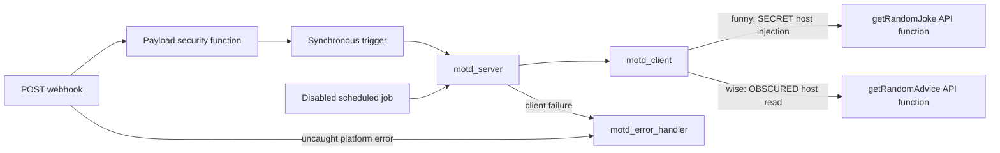

# Sample workflow

A message-of-the-day integration: a protected webhook and scheduled job call a
server function, which calls a client function and one of two trained external
API functions through the Python SDK.



`funny` calls the Official Joke API and joins `setup` and `punchline`.
`wise` calls Advice Slip and returns `slip.advice`. Both reject non-2xx or
malformed responses. The OpenAPI specifications are
[joke_api.json](artefacts/specs/joke_api.json) and
[advice_api.json](artefacts/specs/advice_api.json). Their operation IDs determine
the initial API function names.

## Training and configuration

From the repository root, after configuring the target as described in the
root README:

```bash
ENVPATH=workflows/dev.env uv run --locked python -m cli.operations train-openapi workflows/src/sample_workflow/artefacts/specs --context example.sample_workflow --dry-run
ENVPATH=workflows/dev.env uv run --locked python -m cli.operations train-openapi workflows/src/sample_workflow/artefacts/specs --context example.sample_workflow
ENVPATH=workflows/dev.env uv run --locked python cli/flow.py push --paths sample_workflow --dry-run
ENVPATH=workflows/dev.env uv run --locked python cli/flow.py push --paths sample_workflow
```

Training translates the specs with `hostUrlAsArgument=hostUrl`, enriches their
names/descriptions/arguments with AI, saves reviewable `.poly.json`
models, upserts their schemas/API functions/webhooks, and regenerates the Python
SDK. The sample calls `getRandomJoke` and `getRandomAdvice`; generated async calls
append `_async`. Use `--generate-only` to review AI output before training. If
names change, align the model with these expected names using `--rename FROM TO`
on regeneration, or update the sample's SDK calls to the chosen names.

After the Vari artefacts exist, set `example.sample_workflow.joke_api_config` in
Canopy to `{"hostUrl":"https://official-joke-api.appspot.com"}`. This public URL
is deliberately stored as SECRET to demonstrate secret injection. Its real
value never enters the client function: `.inject("hostUrl")` goes
unchanged into `getRandomJoke_async`. Direct API execution is rejected for this
path because it cannot resolve injected references.

Use Canopy to set this object-valued secret. In SDK 0.3.20, generated Vari
`update()` / `update_async()` methods form-encode Python dictionaries instead
of sending JSON objects; they do not preserve this configuration correctly.

`example.sample_workflow.advice_api_config` is OBSCURED and initially contains
`{"hostUrl":"https://api.adviceslip.com"}`. OBSCURED permits runtime reads while
masking the UI. Python's `get_async()` returns JSON text, so the client decodes
it on every request. Neither configuration nor the injected reference is cached.
No account or API key is needed for these two upstream public APIs.

## Runtime contract

Deployed object arguments use SDK-supported `Dict` annotations, and response
objects use local `TypedDict` definitions. Mood is a string in the generated
contract; both the webhook validator and client enforce `funny` or `wise` at
runtime. Native SDK payload tests verify these argument and return schemas.

Send `{"name":"Reader","mood":"wise"}` to the deployed
`/apis/example-motd/motd` webhook with the target's PolyAPI authorization.
Success returns HTTP 200 and `{"statusCode":200,"message":"Hi Reader! <advice>"}`.

- The webhook requires a PolyAPI key and declares a strict payload schema.
- `validate_motd_payload` checks the name and mood before the trigger runs.
- `motd_server` also validates direct calls; invalid input returns HTTP 400.
- Client failures call the generated `motd_error_handler_async` server function
  and return HTTP 500 with its normalized message.
- The handler retains bounded API status messages; unknown transport errors and
  arbitrary event bodies are not exposed in responses or logs.
- The error trigger covers uncaught failures on this webhook path.
- `example_motd` starts disabled and uses `Scheduler` / `wise` input when enabled.

## Verification

```bash
uv run --locked pytest workflows/src/sample_workflow/tests/test_motd.py
RUN_POLY_INTEGRATION=true uv run --locked --env-file workflows/dev.env pytest workflows/src/sample_workflow/tests/test_motd_integration.py
```

The live tests require `POLY_TEST_WEBHOOK_URL`, a configured secret, and deployed
API functions/workflow resources. Use the webhook `url` from PolyAPI or Canopy,
including its environment subdomain; the gateway base URL alone will not route
webhook execution. Unit tests assert the opaque injection reference
reaches the generated API boundary by identity; that proves caller behavior,
not live platform resolution.
