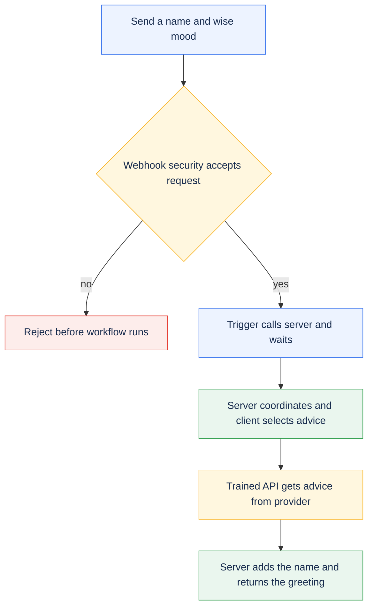
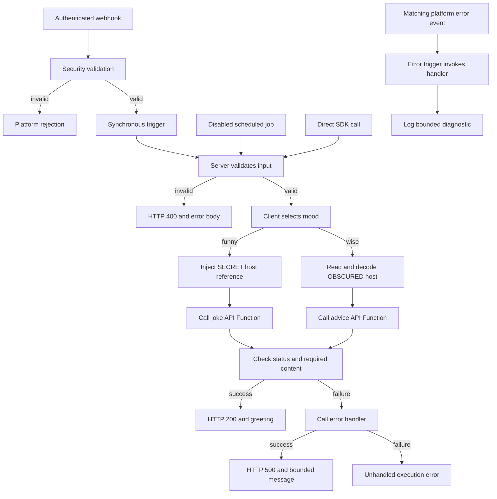

# Message of the day

Build a protected endpoint that greets someone with advice or a joke. This lesson
introduces webhooks, triggers, server and client functions, trained API Functions,
and Vari. After your first request works, explore validation, errors, and the
optional scheduled job.

New to the template? Complete [Getting started](../../../README.md#getting-started)
first. Open a Bash terminal in your **project root**: the folder containing
`pyproject.toml`, `cli/`, and `workflows/`. Run all terminal commands below from
that folder. File settings and Canopy values are labeled separately.

Using a coding agent? Kickstart installs the relevant skills. A manual checkout
already includes the core Python skills; adding the broader
[poly-skills collection](../../../docs/SETUP.md#agent-skills) is optional.
You can complete this lesson without an agent.

## What you are building

Your first request follows the advice path:



**Flow** is this project's command-line tool for creating and updating resources
in PolyAPI. The **generated Python SDK** gives you Python functions for those
resources, such as `poly.*` calls and `vari.*` configuration reads. **Vari** stores
configuration values; **Canopy** is the PolyAPI web interface used below to
manage them. The **PolyAPI runtime** hosts the endpoint and server functions;
client helpers run in their caller's process.

Here, **training an API** means reading its OpenAPI description and creating a
function that your code can call. Training does not call the external API, and
is separate from the [Weather AI lesson](../sample_ai_fx/OVERVIEW.md).

| Building block | Why it exists in this sample | Read the implementation |
| --- | --- | --- |
| Webhook and security function | Accept authenticated HTTP requests and reject invalid input | [Webhook](artefacts/webhooks/motd_hook.json), [validator](server/validate_motd_payload_sfx.py) |
| Trigger | Route the webhook to a function and wait for its result | [Webhook trigger](artefacts/triggers/motd_trigger.json) |
| Server function | Coordinate the request, validate direct calls, and choose the response | [motd_server](server/motd_server_sfx.py) |
| Client function | Select an API by mood and check its result | [motd_client](client/motd_client_cfx.py) |
| API Functions | Make the outbound joke/advice HTTP calls through PolyAPI | [Joke spec](artefacts/specs/joke_api.json), [advice spec](artefacts/specs/advice_api.json) |
| Vari | Demonstrate protected injection and readable configuration | [SECRET joke config](artefacts/vari/joke_api_config.json), [OBSCURED advice config](artefacts/vari/advice_api_config.json) |

## Run your first request

### 1. Confirm setup and namespace

Use a development environment with permission to manage the sample resources,
generate the SDK, and execute functions. Setup saves the verified `TARGET_ENV_ID`
in the selected Flow environment file.

This tutorial assumes you are using `example` as your namespace in
`workflows/dev.env`. **Check this setting in the file**, rather than entering it
as a terminal command:

```env
POLYAPI_NAMESPACE=example
```

A namespace groups your project's functions and other resources in PolyAPI.
The names in this tutorial must match that setting: for example,
`example.sample_workflow` belongs to the `example` namespace.

If you used **kickstart**, this guide and the sample files already use the
namespace you chose. You can continue with those values.

If you set up manually and chose a different namespace, follow the
[manual namespace setup](../../../docs/SETUP.md#configure-a-deployment-target-manually)
before continuing. It updates the starter code and tutorial examples to match.
Changing `POLYAPI_NAMESPACE` in `dev.env` alone does not update those files.
For an existing customized or deployed project, see
[changing a namespace](../../../docs/CONVENTIONS.md#ownership-and-references).

**In your terminal**, select your environment file once per session:

```bash
export ENVPATH=workflows/dev.env
```

Use your setup-selected file if different. Python Flow resolves this path from
the project root; it does not automatically look inside `workflows/` for a bare
`dev.env`. Exporting the path selects the file for Flow; it does not export that
file's contents into your shell.

**In your terminal**, check the sample locally:

```bash
uv run --locked pytest workflows/src/sample_workflow/tests/test_motd.py
```

**Checkpoint:** local checks pass without credentials. They verify Python logic
with mocked SDK boundaries, not deployed PolyAPI behavior.

### 2. Train the two outbound APIs

**In your terminal**, preview the two bundled API descriptions:

```bash
uv run --locked python -m cli.operations train-openapi workflows/src/sample_workflow/artefacts/specs --context example.sample_workflow --disable-ai --dry-run
```

**Check the preview:** it should list `advice_api.json` and `joke_api.json` in
your `example.sample_workflow` context. This command checks local inputs only;
it does not create functions in PolyAPI.

Then run the real training command **in your terminal**:

```bash
uv run --locked python -m cli.operations train-openapi workflows/src/sample_workflow/artefacts/specs --context example.sample_workflow --disable-ai
```

The real command verifies the target, translates the specs with a `hostUrl`
argument, saves `.poly.json` models, creates the API Functions, and regenerates
the Python SDK. `--disable-ai` skips optional AI-generated descriptions and
names, retaining the translator's names.

**Checkpoint:** the command prints `Saved model:` for these new files next to
the original API descriptions:

- `workflows/src/sample_workflow/artefacts/specs/advice_api.poly.json`
- `workflows/src/sample_workflow/artefacts/specs/joke_api.poly.json`

Open them in your editor and look for `getRandomAdvice` and `getRandomJoke`,
each with a `hostUrl` argument and your chosen context. The generated SDK's
asynchronous Python calls end in `_async`, as shown in
[motd_client](client/motd_client_cfx.py). The offline preview cannot establish
those translated names. See [training and SDK reference](#training-and-sdk-reference)
for the SDK file location or if models already exist when you retry.

### 3. Preview and deploy the workflow

Use a branch based on `develop`; see [development branches](#development-branches)
if your checkout is not already configured. **In your terminal**, preview this
sample's deployment:

```bash
uv run --locked python cli/flow.py push-dynamic --paths sample_workflow --dry-run
```

**Check the preview:** confirm the intended environment and namespace. The plan
should include the sample's two variables, four functions, webhook, two
triggers, and disabled job. `push-dynamic` also rebuilds local server functions
that use a changed client function, so check any additional planned changes.

When the plan is correct, deploy it **from your terminal**:

```bash
uv run --locked python cli/flow.py push-dynamic --paths sample_workflow
```

Flow verifies the environment for both commands and normally regenerates the
SDK after deployment.

**Checkpoint:** deployment completes without errors. In Canopy, find the
webhook named `motd` in the `example.sample_workflow` context of your selected
environment. Copy its full `url`, including the environment subdomain. Use that
complete value in the next step; do not build it from the gateway base URL.

### 4. Invoke the advice path

**In the same terminal**, run these prompts. Paste the complete deployed webhook
URL and a PolyAPI key for that same environment, pressing Enter after each.
The key stays hidden while you enter it:

```bash
read -r -p "Paste the full deployed webhook URL: " POLY_TEST_WEBHOOK_URL
read -r -s -p "Paste the PolyAPI key for that environment: " POLY_API_KEY
printf '\n'
```

These values stay in this shell session; do not save them in tracked files.
A value in an env file does not automatically become a Bash variable. If you
prefer env-file loading, use the [live test command](#verification) after
configuring both moods.

Now send the request **from the same terminal**:

```bash
curl -i -X POST "$POLY_TEST_WEBHOOK_URL" \
  --header 'Content-Type: application/json' \
  --header "Authorization: Bearer $POLY_API_KEY" \
  --data '{"name":"Ada","mood":"wise"}'
```

Expect HTTP 200 and a body with this shape; the advice text varies:

```json
{"statusCode":200,"message":"Hi Ada! <advice returned by the provider>"}
```

**Checkpoint:** you have exercised webhook → security function → trigger →
server → client → trained API Function. The advice configuration ships with its
public host URL, so this path needs no extra provider account or secret.

**Your first integration works.** You can stop here or continue below to learn
how to use secrets and change the sample.

### 5. Configure injection and try a joke

This is an optional next step after the advice request succeeds.

**In Canopy**, open your namespace's `sample_workflow.joke_api_config` Vari and
set its value as an **Object**. Paste this JSON as the variable's value, not into
your terminal:

```json
{"hostUrl":"https://official-joke-api.appspot.com"}
```

The host is public, but the sample deliberately marks it SECRET to teach
injection. Flow creates the variable without committing its value. Use Canopy
for this object-valued secret; see [Vari details](#vari-details) for the SDK caveat.

Repeat the request with `"mood":"funny"`. Expect HTTP 200 with a greeting that
joins a joke's setup and punchline:

```json
{"statusCode":200,"message":"Hi Ada! <setup> ... <punchline>"}
```

**Checkpoint:** `.inject("hostUrl")` passes an opaque reference to the API
Function. The platform resolves it at that boundary; the client never reads
the SECRET value.

## Try it yourself

These exercises are optional. Start with the small greeting change, then explore
the other behavior when you are ready.

- In [motd_server](server/motd_server_sfx.py), change the final greeting from
  `Hi` to `Hello`. Repeat the deployment preview and push from step 3, then
  send the advice request again. You should now see `Hello Ada!` followed by
  the advice. Restore `Hi` and redeploy afterward so the checked-in tests and
  response examples still match.
- Change `Ada` to your name and switch between `wise` and `funny`. Trace the two
  branches in [motd_client](client/motd_client_cfx.py).
- Send a whitespace-only name or `"mood":"sleepy"`. Expect rejection before the
  main server runs; inspect both the HTTP status and the platform's response.
- Explain why advice uses a read while the joke uses injection. Neither value
  is cached, and only one can be read by the client.
- Read the [scheduled job](artefacts/jobs/motd_job.json). It calls the server
  directly every 60 minutes with `Scheduler` / `wise`, bypassing webhook
  security. The server therefore repeats input validation. Leave the job
  disabled unless you intend recurring calls.
- Read the mocked provider-failure cases in [the local tests](tests/test_motd.py).
  Observe how failures become bounded messages without exposing raw errors.

## Flow: motd_server

The remaining sections are reference material for understanding or extending
the working sample; they are not extra steps needed for your first request.



The entrypoint accepts the event convention's three arguments: `event`, `headers`,
and `params`. The webhook requires a PolyAPI key and declares a strict payload
schema. Both the validator and server check the name and mood; the client also
rejects an unsupported mood. API results must have a 2xx status and the expected
nonempty fields: `setup` / `punchline` or `slip.advice`.

[The server](server/motd_server_sfx.py) explicitly sets
`polyCustom.responseStatusCode` as well as returning a `statusCode` field. These
are separate concepts: a JSON field alone would not set the HTTP status.
Deployed objects use SDK-supported `Dict` annotations and local `TypedDict`
responses. Mood is a string in the generated contract, checked at runtime.

[The error handler](server/motd_error_handler_sfx.py) preserves only bounded
messages and safe function names; arbitrary transport details and event bodies
are not returned or logged. The server's handled HTTP 500 depends on that handler
call succeeding. Its own failure remains unhandled.

[The error trigger](artefacts/triggers/motd_error_trigger.json) separately selects
platform failures on the webhook path. Its delivery is distinct from the direct
call in the server's `except` block and needs deployed verification. Neither
mechanism persists workflow state; this sample uses no Tabi tables.

## Verification

Run the local tests from step 1 after edits. They check the runtime branches,
including that the opaque injection reference reaches the API boundary unchanged.
The separate [preflight tests](../../../cli/tests/test_preflight.py) also check
native SDK payload schemas. Neither proves live secret resolution.

The live test makes two HTTP calls, one per mood. If you are reusing the URL
and key entered at the prompts in step 4, first make them available to the test
process:

```bash
export POLY_TEST_WEBHOOK_URL POLY_API_KEY
```

Then run the test:

```bash
RUN_POLY_INTEGRATION=true uv run --locked --env-file "$ENVPATH" pytest workflows/src/sample_workflow/tests/test_motd_integration.py
```

It requires deployed resources, the configured joke secret, `POLY_TEST_WEBHOOK_URL`,
and `POLY_API_KEY` in the test process or the selected ignored env file. This HTTP
test does not reuse the SDK's saved key, accept Flow's `API_KEY` alias, or verify
`TARGET_ENV_ID`. Confirm the URL and key belong to the intended environment.
The test does not cover invalid requests, the scheduled job, or error-trigger
delivery.

## Troubleshooting

| Symptom | Check |
| --- | --- |
| Generated function missing | Confirm training, namespace, and generation all used the same environment; inspect the translated names. |
| Target mismatch | Check the selected Flow file and authenticated identity; preserve the target pin. |
| `wise` works, `funny` fails | Set the SECRET Object value in Canopy and use normal API execution, not direct execution. |
| Advice configuration error | Confirm the OBSCURED object contains a nonempty `hostUrl`. |
| Request rejected | Check the full deployed URL, matching key, nonblank name, and allowed mood. |
| HTTP 500 from the server | Inspect its bounded error message and handler logs; check provider status and required fields. |
| Model already exists | Inspect and train the saved `.poly.json` model, or deliberately regenerate with `--overwrite-model`. |

## Training and SDK reference

The specs' operation IDs declare the expected API names. Optional AI enrichment
can change names, descriptions, and arguments; omit `--disable-ai` only when you
intend to review those changes. `--generate-only` saves a translated model for
review but still calls the platform and, unless disabled, its AI enrichment
service. Use `train-model` to train a saved model. Regeneration requires
`--overwrite-model`; `--rename FROM TO` can align changed names during generation.
See [Flow training](../../../cli/README.md#openapi-training-cleanup-and-logs).

Flow normally generates the SDK after relevant pushes. For a separate refresh,
first confirm the native SDK connection, then run:

```bash
uv run --locked --env-file "$ENVPATH" python -m polyapi generate
```

This native command uses saved SDK setup or canonical `POLY_API_BASE_URL` /
`POLY_API_KEY` overrides. It does not resolve Flow's other aliases or enforce
`TARGET_ENV_ID`.

To inspect the generated function definitions in your editor, open
`.venv/lib/python3.12/site-packages/polyapi/poly/<namespace folders>/sample_workflow/__init__.py`
on macOS/Linux, or
`.venv/Lib/site-packages/polyapi/poly/<namespace folders>/sample_workflow/__init__.py`
on Windows. Replace `<namespace folders>` with your namespace; for a dotted
namespace such as `acme.integrations`, use `acme/integrations`. Look for
`getRandomAdvice_async` and `getRandomJoke_async`, each with a `hostUrl` argument.
These files are generated by the SDK; change the source API descriptions and
regenerate instead of editing them directly.

### Vari details

The [joke config](artefacts/vari/joke_api_config.json) is SECRET. Its `.inject()`
reference must go unchanged into `getRandomJoke_async`; normal API execution
resolves it, while the sample rejects direct API execution for this path.
In the pinned SDK 0.3.21.dev1, generated Vari `update()` / `update_async()` methods
form-encode Python dictionaries, so use Canopy to preserve this Object value.

The [advice config](artefacts/vari/advice_api_config.json) is OBSCURED and starts
with `{"hostUrl":"https://api.adviceslip.com"}`. It permits runtime reads while
masking the UI. `get_async()` returns JSON text, decoded on every request.
Neither configuration nor the injection reference is cached. Both upstream APIs
are public and need no account or API key.

### Development branches

Kickstart creates `develop`. For a manual checkout, create it once from `main`
with `git switch -c develop main` if needed. To start a feature:

```bash
git switch develop
git switch -c feature/my-workflow
```

The example configuration binds `develop` to `workflows/dev.env`; branches based
directly on `main` use production safeguards. See
[dependency-aware deployments](../../../cli/README.md#dependency-aware-deployments)
for named functions, nested consumers, exclusions, and interrupted-run recovery.

A full push also includes [common utilities](../utilities/common/OVERVIEW.md) and
[Weather AI](../sample_ai_fx/OVERVIEW.md). Configure their dependencies before
invoking them. The common error trigger starts enabled; the sample job starts
disabled. Canopy and subscription starters stay in
[designs/examples](../../../designs/examples/) until configured and moved into a
workflow's `artefacts/` folder.
