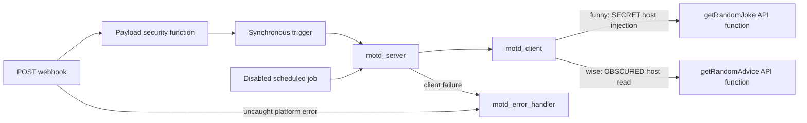

# Sample workflow

New to PolyAPI? Start with the [onboarding tutorial](README.md).

A message-of-the-day integration: a protected webhook and scheduled job call a
server function, which calls a client function and one of two trained external
API functions through the Python SDK.



`funny` calls the Official Joke API and joins `setup` and `punchline`.
`wise` calls Advice Slip and returns `slip.advice`. Both reject non-2xx or
malformed responses. The OpenAPI specifications are
[joke_api.json](artefacts/specs/motd/joke_api.json) and
[advice_api.json](artefacts/specs/motd/advice_api.json). Their operation IDs determine
the initial API function names.

## Training and configuration

From the repository root, after configuring the target as described in the
root README:

```bash
ENVPATH=workflows/dev.env uv run --locked python -m cli.operations train-openapi workflows/src/sample_workflow/artefacts/specs/motd --context example.sample_workflow --disable-ai --dry-run
ENVPATH=workflows/dev.env uv run --locked python -m cli.operations train-openapi workflows/src/sample_workflow/artefacts/specs/motd --context example.sample_workflow --disable-ai
ENVPATH=workflows/dev.env uv run --locked python cli/flow.py push --paths sample_workflow --types functions,variables,schemas,webhooks,triggers,jobs --dry-run
ENVPATH=workflows/dev.env uv run --locked python cli/flow.py push --paths sample_workflow --types functions,variables,schemas,webhooks,triggers,jobs
```

Training translates the specs with `hostUrlAsArgument=hostUrl`, optionally enriches
metadata when `--disable-ai` is omitted, saves reviewable `.poly.json`
models, upserts their schemas/API functions/webhooks, and regenerates the Python
SDK. The sample calls `getRandomJoke` and `getRandomAdvice`; generated async calls
append `_async`. Use `--generate-only` to review AI output before training. If
names change, align the model with these expected names using `--rename FROM TO`
on regeneration, or update the sample's SDK calls to the chosen names.

After the Vari artefacts exist, set `example.sample_workflow.joke_api_config` in
Canopy to `{"hostUrl":"https://official-joke-api.appspot.com"}`. This public URL
is deliberately stored as SECRET to demonstrate secret injection. Its real
value never enters the client function: `.inject("hostUrl")` goes
unchanged into `getRandomJoke_async`. Direct API execution is rejected for this
path because it cannot resolve injected references.

Use Canopy to set this object-valued secret. Generated Vari
`update()` / `update_async()` methods form-encode Python dictionaries instead
of sending JSON objects; they do not preserve this configuration correctly.

`example.sample_workflow.advice_api_config` is OBSCURED and initially contains
`{"hostUrl":"https://api.adviceslip.com"}`. OBSCURED permits runtime reads while
masking the UI. Python's `get_async()` returns JSON text, so the client decodes
it on every request. Neither configuration nor the injected reference is cached.
No account or API key is needed for these two upstream public APIs.

## Runtime contract

Deployed object arguments use SDK-supported `Dict` annotations, and response
objects use local `TypedDict` definitions. Mood is a string in the generated
contract; both the webhook validator and client enforce `funny` or `wise` at
runtime. Native SDK payload tests verify these argument and return schemas.

Send `{"name":"Reader","mood":"wise"}` to the deployed
`/apis/example-motd/motd` webhook with the target's PolyAPI authorization.
Success returns HTTP 200 and `{"statusCode":200,"message":"Hi Reader! <advice>"}`.

- The webhook requires a PolyAPI key and declares a strict payload schema.
- `validate_motd_payload` checks the name and mood before the trigger runs.
- `motd_server` also validates direct calls; invalid input returns HTTP 400.
- Client failures call the generated `motd_error_handler_async` server function
  and return HTTP 500 with its normalized message.
- The handler retains bounded API status messages; unknown transport errors and
  arbitrary event bodies are not exposed in responses or logs.
- The error trigger covers uncaught failures on this webhook path.
- `example_motd` starts disabled and uses `Scheduler` / `wise` input when enabled.

## Verification

```bash
uv run --locked pytest workflows/src/sample_workflow/tests/test_motd.py
RUN_POLY_INTEGRATION=true uv run --locked --env-file workflows/dev.env pytest workflows/src/sample_workflow/tests/test_motd_integration.py
```

The live tests require `POLY_TEST_WEBHOOK_URL`, a configured secret, and deployed
API functions/workflow resources. Use the webhook `url` from PolyAPI or Canopy,
including its environment subdomain; the gateway base URL alone will not route
webhook execution. Unit tests assert the opaque injection reference
reaches the generated API boundary by identity; that proves caller behavior,
not live platform resolution.

## Weather AI

`example.sample_workflow.uplifting_weather` accepts a city or town in `location`
and optional `activity`. It calls `searchLocations` for coordinates, then
`getCurrentWeather` for current conditions, and returns practical guidance.
Both tools use [Open-Meteo](https://open-meteo.com/), with no weather account,
API key, or trial needed for evaluation.

The public API supports evaluation and non-commercial use. Review
[Open-Meteo's terms and commercial plans](https://open-meteo.com/en/pricing)
before production use. The target still needs the AI provider/model selected in
[the AI artefact](artefacts/ai-functions/uplifting_weather.json); AI execution can
incur provider charges. Configure the tenant provider before running the AI test.

### Configure the AI provider

The sample uses OpenAI through the PolyAPI tenant configuration:

1. Have a tenant administrator store the OpenAI API key as a **SECRET string
   Vari** in the selected tenant. Keep shared provider configuration outside
   this sample's disposable namespace.
2. Set the tenant's `OpenAITenantApiKey` configuration to that Vari's UUID.
   The value is the variable ID, not the provider key. The administrative API
   is `PATCH /tenants/{tenantId}/config-variables/OpenAITenantApiKey` with JSON
   body `{"value":"<SECRET_VARI_UUID>"}`. It requires a user-bound PolyAPI key
   with `ManageTenant` permission and a current `x-otp` MFA code.
3. Confirm the OpenAI project has API credits and access to the configured model.

Keep the provider key in Vari; it does not belong in the local environment file
or AI artefact. The weather tools themselves need no credentials.

A missing tenant configuration returns `403`. A provider failure can appear to
the caller as a generic `500`; inspect the AI execution logs and correlate their
execution ID and timestamp with gateway logs. An upstream `401` indicates an
invalid key, while a `429` stating no credits remain requires billing attention.
Do not retry that quota failure until the provider account is funded or the
administrator replaces the Vari value with a funded project's key. Do not copy
provider key fragments from logs into reports.

### Train the weather tools

Configure the target and replace `example` with your namespace as described in
the root README. From the repository root:

```bash
ENVPATH=workflows/dev.env uv run --locked python -m cli.operations train-openapi workflows/src/sample_workflow/artefacts/specs/weather --context example.sample_workflow --dry-run --disable-ai
ENVPATH=workflows/dev.env uv run --locked python -m cli.operations train-openapi workflows/src/sample_workflow/artefacts/specs/weather --context example.sample_workflow --disable-ai
```

The bundled [geocoding spec](artefacts/specs/weather/geocoding_api.json) and
[weather spec](artefacts/specs/weather/weather_api.json) define the exact tool names and
arguments used by the AI artefact. PolyAPI translates the provider query name
`temperature_unit` to the generated argument `temperatureUnit`; the binding uses
that generated name. `--disable-ai` skips optional training-time
metadata enrichment to preserve those contracts; it does not disable the AI
sample. Training saves `.poly.json` models next to the specs and regenerates the
Python SDK. To retrain a saved model, use `train-model` as documented in the
[Flow reference](../../../cli/README.md#openapi-training-cleanup-and-logs).

### Deploy and invoke

The tools and AI function live in the same project namespace. The AI supplies
only the location search text and returned coordinates; fixed argument bindings
select public hosts, Celsius, and the required weather fields. No weather Vari
or provider secret is required.

```bash
ENVPATH=workflows/dev.env uv run --locked python cli/flow.py push --paths sample_workflow --types ai-functions --dry-run
ENVPATH=workflows/dev.env uv run --locked python cli/flow.py push --paths sample_workflow --types ai-functions
```

The structured result contains `location`, `currentWeather`, `description`,
`recommendedItems`, `upliftingMessage`, and `attribution`. Display the attribution
with the result: weather data comes from Open-Meteo under CC BY 4.0 and location
data from GeoNames. Recommendations are AI-generated. Current conditions are
model-based estimates, not station observations or official alerts.

If the tools find no location or usable weather, the prompt requests
`currentWeather: null`, an explanation, and no recommended items. Execution or
provider errors can still propagate to the caller; callers should handle them.

### Verify

Local tests validate the tool/spec bindings and output contract without network
calls or provider credentials:

```bash
uv run --locked pytest workflows/src/sample_workflow/tests/test_weather_contract.py
```

The deployed test calls the generated Python SDK. It needs both explicit opt-ins
because the AI call can incur provider usage:

```bash
RUN_POLY_INTEGRATION=true RUN_AI_INTEGRATION=true uv run --locked --env-file workflows/dev.env pytest workflows/src/sample_workflow/tests/test_weather_integration.py
```
