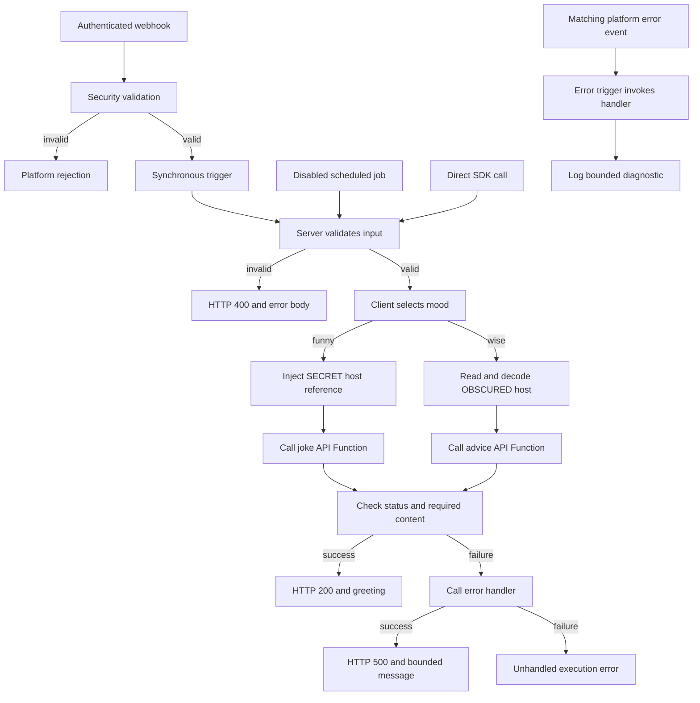
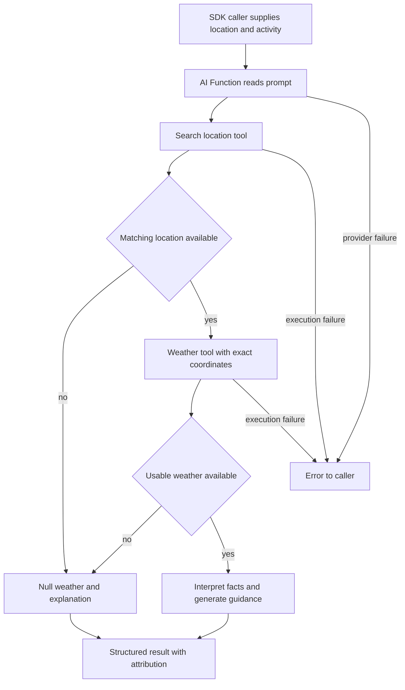

# Sample workflow runtime reference

Start with the [onboarding tutorial](README.md). This copy uses the `example`
namespace; keep its source, artefacts, and generated SDK calls aligned.

## Runtime reference

The remaining sections are reference material for understanding or extending the
working sample; they are not extra steps needed for your first request.

### Request and response



The entrypoint accepts the event convention's three arguments: `event`, `headers`,
and `params`. The webhook requires a PolyAPI key and declares a strict payload
schema. Both the validator and server check the name and mood; the client also
rejects an unsupported mood. API results must have a 2xx status and the expected
nonempty fields: `setup` / `punchline` or `slip.advice`.

[The server](server/motd_server_sfx.py) explicitly sets
`polyCustom.responseStatusCode` as well as returning a `statusCode` field. These
are separate concepts: a JSON field alone would not set the HTTP status.
Deployed objects use SDK-supported `Dict` annotations and local `TypedDict`
responses. Mood is a string in the generated contract, checked at runtime.

Each deployable Python file keeps its `polyConfig` and runtime types inline.
The webhook declares its payload schema in its JSON artefact; the sample does
not use a separate schema artefact or persist workflow state in Tabi tables.

### Error handling

[The error handler](server/motd_error_handler_sfx.py) preserves only bounded
messages and safe function names; arbitrary transport details and event bodies
are not returned or logged. The server's handled HTTP 500 depends on that handler
call succeeding. Its own failure remains unhandled.

[The error trigger](artefacts/triggers/motd_error_trigger.json) separately selects
platform failures on the webhook path. Its delivery is distinct from the direct
call in the server's `except` block and needs deployed verification.

### Scheduled calls

The [scheduled job](artefacts/jobs/motd_job.json) starts disabled. When enabled,
it calls `motd_server` directly every 60 minutes with `name: "Scheduler"` and
`mood: "wise"`, plus empty headers and parameters. It does not pass through the
webhook or its security function, so the server repeats input validation.

Leave the job disabled while following this tutorial. If you later want
recurring calls, set its `enabled` field to `true` and repeat the
[deployment preview and push](README.md#3-preview-and-deploy-the-workflow). Review its
execution results separately from the webhook response: a job has no HTTP caller.

## Verification

Run the local tests from [step 1](README.md#1-confirm-setup-and-namespace) after edits. They check the runtime branches,
including that the opaque injection reference reaches the API boundary unchanged.
The separate [preflight tests](../../../cli/tests/test_preflight.py) also check
native SDK payload schemas. Neither proves live secret resolution.

The live test makes two HTTP calls, one per mood. If you are reusing the URL
and key entered at the prompts in step 4, first make them available to the test
process:

```bash
export POLY_TEST_WEBHOOK_URL POLY_API_KEY
```

Then run the test:

```bash
RUN_POLY_INTEGRATION=true uv run --locked --env-file "$ENVPATH" pytest workflows/src/sample_workflow/tests/test_motd_integration.py
```

It requires deployed resources, the configured joke secret, `POLY_TEST_WEBHOOK_URL`,
and `POLY_API_KEY` in the test process or the selected ignored env file. This HTTP
test does not reuse the SDK's saved key, accept Flow's `API_KEY` alias, or verify
`TARGET_ENV_ID`. Confirm the URL and key belong to the intended environment.
The test does not cover invalid requests, the scheduled job, or error-trigger
delivery.

## Troubleshooting

| Symptom | Check |
| --- | --- |
| Generated function missing | Confirm training, namespace, and generation all used the same environment; inspect the translated names. |
| Target mismatch | Check the selected Flow file and authenticated identity; preserve the target pin. |
| `wise` works, `funny` fails | Set the SECRET Object value in Canopy and use normal API execution, not direct execution. |
| Advice configuration error | Confirm the OBSCURED object contains a nonempty `hostUrl`. |
| Request rejected | Check the full deployed URL, matching key, nonblank name, and allowed mood. |
| HTTP 500 from the server | Inspect its bounded error message and handler logs; check provider status and required fields. |
| Model already exists | Inspect and train the saved `.poly.json` model, or deliberately regenerate with `--overwrite-model`. |

## Training and SDK reference

The specs' operation IDs declare the expected API names. Optional AI enrichment
can change names, descriptions, and arguments; omit `--disable-ai` only when you
intend to review those changes. `--generate-only` saves a translated model for
review but still calls the platform and, unless disabled, its AI enrichment
service. Use `train-model` to train a saved model. Regeneration requires
`--overwrite-model`; `--rename FROM TO` can align changed names during generation.
See [Flow training](../../../cli/README.md#openapi-training-cleanup-and-logs).

Flow normally generates the SDK after relevant pushes. For a separate refresh,
first confirm the native SDK connection, then run:

```bash
uv run --locked --env-file "$ENVPATH" python -m polyapi generate
```

This native command uses saved SDK setup or canonical `POLY_API_BASE_URL` /
`POLY_API_KEY` overrides. It does not resolve Flow's other aliases or enforce
`TARGET_ENV_ID`.

To inspect the generated function definitions in your editor, open
`.venv/lib/python3.12/site-packages/polyapi/poly/<namespace folders>/sample_workflow/__init__.py`
on macOS/Linux, or
`.venv/Lib/site-packages/polyapi/poly/<namespace folders>/sample_workflow/__init__.py`
on Windows. Replace `<namespace folders>` with your namespace; for a dotted
namespace such as `acme.integrations`, use `acme/integrations`. Look for
`getRandomAdvice_async` and `getRandomJoke_async`, each with a `hostUrl` argument.
These files are generated by the SDK; change the source API descriptions and
regenerate instead of editing them directly.

### Vari details

Vari secrecy levels control how code and humans can access a stored value.
The platform supports `NONE`, `OBSCURED`, `SECRET`, and `PARTIAL`; this sample
uses two levels to demonstrate the difference, even though both values are
public API base URLs.

The [joke config](artefacts/vari/joke_api_config.json) is SECRET. Its `.inject()`
reference must go unchanged into `getRandomJoke_async`; normal API execution
resolves it, while the sample rejects direct API execution for this path.
In the pinned SDK 0.3.21.dev1, generated Vari `update()` / `update_async()` methods
form-encode Python dictionaries, so use Canopy to preserve this Object value.

The [advice config](artefacts/vari/advice_api_config.json) is OBSCURED and starts
with `{ "hostUrl": "https://api.adviceslip.com" }`. It permits runtime reads while
masking the UI. `get_async()` returns JSON text, decoded on every request.
Neither configuration nor the injection reference is cached. Both upstream APIs
are public and need no account or API key.

### Development branches

Kickstart creates `develop`. For a manual checkout, create it once from `main`
with `git switch -c develop main` if needed. To start a feature:

```bash
git switch develop
git switch -c feature/my-workflow
```

The example configuration binds `develop` to `workflows/dev.env`; branches based
directly on `main` use production safeguards. See
[dependency-aware deployments](../../../cli/README.md#dependency-aware-deployments)
for named functions, nested consumers, exclusions, and interrupted-run recovery.

A full push also includes [common utilities](../utilities/common/OVERVIEW.md) and
[Weather AI](#weather-ai). Configure their dependencies before
invoking them. The common error trigger starts enabled; the sample job starts
disabled. Canopy and subscription starters stay in
[designs/examples](../../../designs/examples/) until configured and moved into a
workflow's `artefacts/` folder.

## Weather AI

Ask for current weather and practical advice for an activity. This lesson shows
how an AI Function combines **tool-provided facts**, **fixed configuration**, and
**generated guidance** in a structured result.

Complete [Getting started](../../../README.md#getting-started) first. If you are
new to API training and the generated SDK, start with
[Message of the day](README.md). Run commands from the project
root in Bash.

Coding-agent skills are optional for this lesson. Kickstart installs them;
manual checkouts already include the core Python skills. See the
[skills guide](../../../docs/SETUP.md#agent-skills) for the broader collection.

### What you will learn

The function accepts a required `location` and optional `activity`. It searches
for coordinates, asks a weather API for current conditions, then generates
activity-aware guidance. The tools use Open-Meteo and need no weather account or
API key for evaluation. The AI Function still requires configured OpenAI access
and can incur provider charges.

| Part of the lesson | Purpose | Source |
| --- | --- | --- |
| Location tool | Convert a place name into candidate coordinates | [Geocoding spec](artefacts/specs/weather/geocoding_api.json) |
| Weather tool | Fetch current conditions at the selected coordinates | [Weather spec](artefacts/specs/weather/weather_api.json) |
| AI Function | Define inputs, prompt, allowed tools, fixed arguments, and result shape | [uplifting_weather](artefacts/ai-functions/uplifting_weather.json) |
| Contract tests | Check the local bindings and output schema | [Local tests](tests/test_weather_contract.py) |
| Runtime test | Invoke one deployed example and check its result | [Integration test](tests/test_weather_integration.py) |

### Run the lesson

#### 1. Confirm the prerequisites

Use the target configured during setup and ask its administrator to confirm
OpenAI provider access and the model named in the AI artefact (`gpt-5.5`). If it
is not configured, use [provider setup](#provider-setup-reference) below before
invoking the function.

The context root must match `POLYAPI_NAMESPACE`. Kickstart updates the sample,
utilities, and copied tutorial examples to your chosen root. This copy uses
`example`. For a fresh manual checkout, run the local namespace-alignment step in
[manual setup](../../../docs/SETUP.md#configure-a-deployment-target-manually)
to update the starter code, artefacts, and examples together. Changing the
environment variable alone is insufficient. For already-customized or deployed
projects, follow [ownership and references](../../../docs/CONVENTIONS.md#ownership-and-references).

Select your setup-configured file once per terminal session:

```bash
export ENVPATH=workflows/dev.env
```

Python Flow resolves relative paths from the project root. Use the full
`workflows/dev.env` path, or the selected file if different. Direct SDK calls
below load that same file explicitly with `uv --env-file "$ENVPATH"`.

Keep the intended environment's `TARGET_ENV_ID` in that file. Kickstart and
`flow setup` save this pin; it is separate from your namespace and does not
change your login. See [target pinning](../../../docs/SETUP.md#pin-the-target-environment)
for manual setup or a mismatch.

Use the project's [pinned Python SDK](../../../docs/SETUP.md#python-sdk-version-and-target)
and configured connection before this lesson. Kickstart installs that pin for
every region; it does not select SDK packages using TypeScript's instance tags.

Run the local contract checks:

```bash
uv run --locked pytest workflows/src/sample_workflow/tests/test_weather_contract.py
```

**Checkpoint:** these tests pass without credentials. They verify the checked-in
contracts, not the remote translator, model behavior, or weather accuracy.

#### 2. Train the weather tools

Preview the bundled specifications, then train them:

```bash
uv run --locked python -m cli.operations train-openapi workflows/src/sample_workflow/artefacts/specs/weather --context example.sample_workflow --dry-run --disable-ai
uv run --locked python -m cli.operations train-openapi workflows/src/sample_workflow/artefacts/specs/weather --context example.sample_workflow --disable-ai
```

The preview checks local inputs only. Real training verifies the target, saves
`.poly.json` models beside the specs, registers the tools, and regenerates the
Python SDK. `--disable-ai` skips optional metadata enrichment; it does not disable
the AI Function you will invoke later.

**Checkpoint:** inspect the translated models for `searchLocations` and
`getCurrentWeather` in your namespace. Match their argument keys to the AI
artefact. In particular, the weather binding expects `temperatureUnit`, translated
from the provider's `temperature_unit`. The offline preview cannot prove that
translation. To retry saved models or deliberately regenerate them, follow
[Flow training](../../../cli/README.md#openapi-training-cleanup-and-logs).

#### 3. Deploy the AI Function

If `POLY_DEPLOY_SKIP_PATHS` excludes `workflows/src/sample_workflow` or a parent
folder, remove that exclusion in the selected environment file first. `--paths`
does not override it. See [skipping samples](../../../docs/SETUP.md#skip-sample-deployments)
for how to keep the lesson files while excluding them from normal pushes.

```bash
uv run --locked python cli/flow.py push --paths sample_workflow --types ai-functions --dry-run
uv run --locked python cli/flow.py push --paths sample_workflow --types ai-functions
```

Review the target and plan before the real push. Flow verifies the environment
and normally regenerates the SDK afterward. This push deploys the AI contract;
training in step 2 creates its two outbound tools.

**Checkpoint:** Canopy and the generated SDK contain
`example.sample_workflow.uplifting_weather` under your chosen root, with `location`
and optional `activity` arguments. The function is enabled, its two tools resolve,
and the tenant's model provider is ready.

#### 4. Ask for weather guidance

The following direct SDK call uses its saved connection or canonical
`POLY_API_BASE_URL` / `POLY_API_KEY` overrides from your selected file. It does
not apply Flow's aliases or `TARGET_ENV_ID` check. Confirm that the generated
bindings and connection are for the intended environment. Substitute your
namespace in the Python call if different from `example`.

```bash
uv run --locked --env-file "$ENVPATH" python - <<'PY'
import asyncio
import json
from polyapi import poly

async def main():
    result = await poly.example.sample_workflow.uplifting_weather_async(
        "London, United Kingdom", "an outdoor walk"
    )
    print(json.dumps(result, indent=2))

asyncio.run(main())
PY
```

An illustrative response follows. The numbers and prose are examples, not a live
weather report:

```json
{
  "location": "London, United Kingdom",
  "currentWeather": {
    "condition": "Partly cloudy",
    "temperature": 14,
    "unit": "C"
  },
  "description": "A light layer may help during your walk.",
  "recommendedItems": ["Light jacket", "Comfortable shoes"],
  "upliftingMessage": "Enjoy a change of scenery on your walk!",
  "attribution": "Weather data: Open-Meteo (https://open-meteo.com/), CC BY 4.0. Location data: GeoNames (https://www.geonames.org/). Guidance is AI-generated."
}
```

**Checkpoint:** the result follows the declared schema and includes attribution.
The location and weather fields should be grounded in tool data; the description,
items, and uplifting message are AI-generated interpretations. A valid schema
alone does not prove factual accuracy.

### How the AI contract works



In [the AI artefact](artefacts/ai-functions/uplifting_weather.json):

- `arguments` declares what callers supply. `inputTemplate` combines those inputs
  into a request; `systemPrompt` defines the behavior and failure instructions.
- `toolFunctions` limits the available tools. The AI selects search text and
  coordinates; fixed bindings select provider hosts, Celsius, and weather fields.
- `outputSchema` requires `location`, `currentWeather`, `description`,
  `recommendedItems`, `upliftingMessage`, and `attribution`, with no extra keys.
- If no location or usable weather is found, the prompt requests null weather,
  an explanation, and no recommended items. Execution errors can still propagate
  instead of producing that result; callers should handle them.

This AI invocation uses the SDK directly; it does not use the message-of-the-day
webhook, server functions, or scheduled job. It has no Tabi state.
The two trained tools and AI Function live in the project namespace; shared
provider configuration belongs outside its disposable resources.

Display attribution with the result. Open-Meteo weather is model-based current
estimates, not station observations, forecasts for a requested future date, or
official alerts. Its public API supports evaluation and non-commercial use;
review [the provider's terms and commercial plans](https://open-meteo.com/en/pricing)
before production use.

### Try it yourself

- Keep the location fixed and change the activity to cycling. Expect the same
  output structure and activity-specific guidance; current measurements can
  change between calls.
- Omit the second argument. The optional activity should not be necessary for a
  useful response. Confirm this behavior in your environment.
- Use an ambiguous place name, then add its country. Inspect how the resolved
  location changes and why the selected coordinates matter.
- Trace `temperatureUnit` from the weather spec through the translated model to
  its fixed binding. Changing that binding also requires aligning the prompt,
  output schema, and tests; a schema is part of the contract.
- Inspect the no-match instructions. A live exercise should check for null weather
  and empty items rather than assume the model obeyed the prompt.

### Verification and troubleshooting

After the manual call, the opt-in deployed test checks one London/outdoor-walk
response:

```bash
RUN_POLY_INTEGRATION=true RUN_AI_INTEGRATION=true uv run --locked --env-file "$ENVPATH" pytest workflows/src/sample_workflow/tests/test_weather_integration.py
```

Both flags are required because the call incurs provider usage. The test validates
the schema, nonempty text, non-null weather, Celsius, and attribution. It does not
check factual agreement with upstream measurements, no-match behavior, or tool
failures. Like the direct SDK example, it does not enforce Flow's target pin.

| Symptom | Check |
| --- | --- |
| Tool or SDK name missing | Confirm the namespace, translated names, training, and SDK generation for the same target. |
| Tool arguments rejected | Compare the translated model with each `argumentConfig` key, especially `temperatureUnit`. |
| Weather is null | Check the resolved location and tool results before treating it as a model problem. |
| Permission or provider error | Ask the administrator to check AI execution access and tenant provider configuration. |
| Generic server error | Correlate the AI execution ID and timestamp with gateway logs; a status alone does not establish the cause. |
| Provider authentication or quota error | Distinguish authentication, rate limiting, and exhausted quota before retrying. |

### Provider setup reference

The sample uses OpenAI through PolyAPI's tenant configuration. Provider setup and
permission to execute the AI Function are prerequisites; see the
[platform AI guide](https://docs.polyapi.io/ai_functions/index.html).

1. Have a tenant administrator store the OpenAI API key as a **SECRET string Vari**
   in the selected tenant, outside this sample's disposable namespace.
2. Set `OpenAITenantApiKey` to that Vari's UUID, not the provider key. Confirm the
   configuration name and update contract in the selected instance's Swagger
   before using `PATCH /tenants/{tenantId}/config-variables/OpenAITenantApiKey`
   with `{"value":"<SECRET_VARI_UUID>"}`. This procedure is outside Flow and the
   sample's tests; confirm its `ManageTenant`, user-key, and `x-otp` requirements.
3. Confirm the OpenAI project has credits and access to the configured model.

Keep the provider key in Vari, outside local env files and the AI artefact. The
Open-Meteo tools need no weather-provider secret.

For `403`, check execution permissions and tenant provider setup. For an upstream
`401`, check provider authentication. Distinguish a rate-limit `429` from a
quota/billing `429`; the latter needs account attention. See
[OpenAI's error guide](https://developers.openai.com/api/docs/guides/error-codes).
Exact gateway mappings depend on the target and are not verified by local tests.
Do not copy provider key fragments from logs into reports.

### Migrating the former AI sample

Moving local files does not rename deployed resources. Existing checkouts may
still have weather resources under `example.sample_ai_fx`. Train the tools and
deploy the AI function in `example.sample_workflow`, regenerate the SDK, and
verify that invocation before separately reviewing cleanup of the former
context. This source change does not delete remote resources.

## Weather MCP server

Offer the same two weather tools to MCP clients, such as Claude, an IDE agent, or
the MCP Inspector. In the Weather AI lesson a PolyAPI-hosted model calls the
tools; here a model you do not control decides when to call them, and PolyAPI
runs each call with the bindings you fixed. No AI provider setup is needed.

### What this lesson covers

| Part of the lesson | Purpose | Source |
| --- | --- | --- |
| MCP server | Choose the tools, leave only the place and coordinates to the client, and fix hosts and units | [weather_tools](artefacts/mcp-servers/weather_tools.json) |
| Weather tools | The trained API Functions the Weather AI lesson also uses | [Geocoding spec](artefacts/specs/weather/geocoding_api.json), [weather spec](artefacts/specs/weather/weather_api.json) |
| Contract tests | Pin the exposed tools, their bindings, and private visibility | [Local tests](tests/test_weather_tools_contract.py) |

### Deploy and call the server

#### 1. Check the contract and train the tools

Select your Flow file as in [Weather AI step 1](#1-confirm-the-prerequisites),
then run the offline checks:

```bash
export ENVPATH=workflows/dev.env
uv run --locked pytest workflows/src/sample_workflow/tests/test_weather_tools_contract.py
```

If you completed [Weather AI step 2](#2-train-the-weather-tools), the tools are
already trained. Otherwise, train them in the same environment:

```bash
uv run --locked python -m cli.operations train-openapi workflows/src/sample_workflow/artefacts/specs/weather --context example.sample_workflow --disable-ai
```

**Checkpoint:** the contract tests pass, and training lists `searchLocations`
and `getCurrentWeather` under `example.sample_workflow`.

#### 2. Deploy the server

If `POLY_DEPLOY_SKIP_PATHS` excludes `workflows/src/sample_workflow`, remove that
exclusion first; see [skipping samples](../../../docs/SETUP.md#skip-sample-deployments).

```bash
uv run --locked python cli/flow.py push --paths sample_workflow --types mcp-servers --dry-run
uv run --locked python cli/flow.py push --paths sample_workflow --types mcp-servers
```

The preview should show `Would apply POST /mcp-servers` for
`example-weather-tools`. MCP servers have no namespace context, so Flow finds
them by name, which must be unique in the environment; kickstart names the
server after your namespace. If the preview shows a `PATCH` although you never
deployed it, another project uses that name: stop and choose a different name
before pushing.

**Checkpoint:** the push prints
`MCP URL for example-weather-tools: https://<instance>/mcp-servers/<id>/mcp`.
Copy that URL.

#### 3. Connect a client

The server is private. PolyAPI rejects anonymous calls and PolyAPI keys for
private servers and accepts only OAuth sign-ins, which need an OAuth client this
lesson does not configure. To try the server, make it public briefly: while it
is public, anyone with its URL can call the two tools. They only read public
Open-Meteo data, and step 5 makes the server private again.

Set `"isPublic": true` in [weather_tools.json](artefacts/mcp-servers/weather_tools.json),
then push:

```bash
uv run --locked python cli/flow.py push --paths sample_workflow --types mcp-servers
```

Flow warns that the server is public, and the `PATCH` changes only `isPublic`.
The contract tests fail while it is public; that is their job.

Connect with curl, kickstart's one prerequisite. Replace the URL with yours:

```bash
MCP_URL='https://<instance>/mcp-servers/<id>/mcp'
mcp() { curl -s "$MCP_URL" -H 'Content-Type: application/json' -H 'Accept: application/json, text/event-stream' -d "$1"; echo; }
mcp '{"jsonrpc":"2.0","id":1,"method":"initialize","params":{"protocolVersion":"2025-06-18","capabilities":{},"clientInfo":{"name":"tutorial","version":"1.0.0"}}}'
mcp '{"jsonrpc":"2.0","method":"notifications/initialized"}'
mcp '{"jsonrpc":"2.0","id":2,"method":"tools/list"}'
```

If Node.js is installed, the [MCP Inspector](https://modelcontextprotocol.io/docs/tools/inspector)
offers the same calls in a browser: run `npx @modelcontextprotocol/inspector`,
choose the **Streamable HTTP** transport, paste the MCP URL, select **Connect**,
then **List Tools** under **Tools**.

**Checkpoint:** two tools appear: `example_sample_workflow_searchLocations`, with
the input `name`, and `example_sample_workflow_getCurrentWeather`, with
`latitude` and `longitude`. The fixed hosts, result count, and units do not
appear as inputs: PolyAPI applies them.

#### 4. Call a sample tool

Search for a place, then pass one result's latitude and longitude to the weather
tool:

```bash
mcp '{"jsonrpc":"2.0","id":3,"method":"tools/call","params":{"name":"example_sample_workflow_searchLocations","arguments":{"name":"Bratislava"}}}'
mcp '{"jsonrpc":"2.0","id":4,"method":"tools/call","params":{"name":"example_sample_workflow_getCurrentWeather","arguments":{"latitude":48.14816,"longitude":17.10674}}}'
```

**Checkpoint:** the location search returns at most three matches, because the
server fixes `count` at 3, each with coordinates, such as Bratislava, Slovakia,
at about 48.15, 17.11. The weather call returns current conditions for them.

#### 5. Make the server private again

Set `"isPublic": false`, confirm the contract, and push:

```bash
uv run --locked pytest workflows/src/sample_workflow/tests/test_weather_tools_contract.py
uv run --locked python cli/flow.py push --paths sample_workflow --types mcp-servers
```

**Checkpoint:** the same curl calls now return `403` with
`MCP server is private`.

### How the MCP server works

- The client's model chooses which tool to call and when. It sees each tool's
  name, which joins the context and function name with underscores and so shows
  your namespace, and the description trained from the spec. Improve a
  description in the spec before exposing a tool.
- Only `ai` arguments become tool inputs. PolyAPI applies `hardcoded` values
  without showing them, so the client cannot change the provider host or units.
- `toolFunctions` is the complete tool list: removing an entry removes the tool
  on the next push.
- Sharing a private server needs OAuth: set `oauthClientId` and
  `oauthClientSecretVariable` as described in
  [Flow's MCP reference](../../../cli/README.md#mcp-servers).
- Flow never deletes MCP servers. Delete `example-weather-tools` in PolyAPI when
  you no longer need it.

### Explore the MCP server

- Remove `getCurrentWeather` from `toolFunctions`, push while the server is
  public, and list the tools again: only the location search remains. The
  contract tests fail, flagging the narrowed tool surface in review. Restore
  the tool afterwards.
- Change the fixed `count` from 3 to 1, push, and repeat the location search.

### MCP troubleshooting

| Symptom | Check |
| --- | --- |
| `403` with `MCP server is private` | The server is private; follow step 3 to try it from a client. |
| `401` with `Invalid OIDC access token` | A PolyAPI key was sent as a bearer token; private servers accept only OAuth sign-ins. |
| Push stops: tool not found among API or server functions in this environment | Train the weather tools in the same environment, as in step 1. |
| Preview shows a `PATCH` for a server you never deployed | Another project uses the name; rename the server before pushing. |
| Server still listed after you delete the artefact | Flow never deletes MCP servers; delete it in PolyAPI. |
