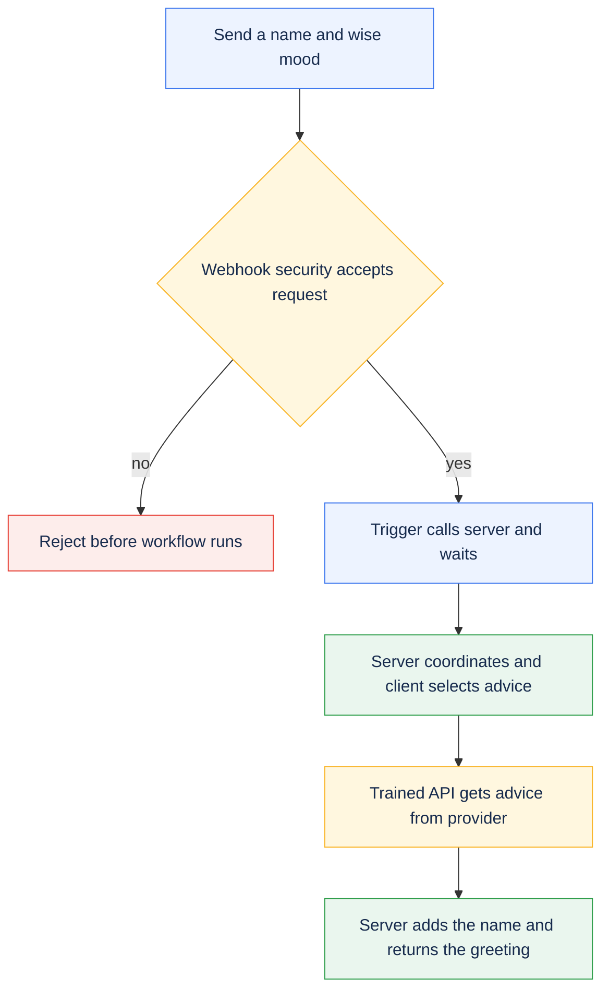

# Build your first PolyAPI workflow in Python

Build a protected endpoint that greets someone with advice or a joke. This lesson
introduces webhooks, triggers, server and client functions, trained API Functions,
and Vari. After your first request works, explore validation, errors, and the
optional scheduled job.

New to the template? Complete [Getting started](../../../README.md#getting-started)
first. Open a Bash or zsh terminal in your **project root**: the folder containing
`pyproject.toml`, `cli/`, and `workflows/`. Run all terminal commands below from
that folder. File settings and Canopy values are labeled separately.

Using a coding agent? Kickstart installs the relevant skills. A manual checkout
already includes the core Python skills; adding the broader
[poly-skills collection](../../../docs/SETUP.md#agent-skills) is optional.
You can complete this lesson without an agent.

## PolyAPI foundations

A **tenant** contains **environments**, each with its own resource catalog. The
URL and API key select the actual target; local `dev.env` and `prod.env` filenames
are conventions. The namespace identifies the resources this project owns.
Read the [mental model](https://docs.polyapi.io/concepts/mental_model.html),
[resource guide](https://docs.polyapi.io/concepts/choosing-a-resource.html),
[environment guide](https://docs.polyapi.io/environments/ui.html), and
[Python SDK guide](https://docs.polyapi.io/generated_sdks/python.html).

```text
workflows/src/sample_workflow/
  README.md                 First-request onboarding tutorial
  OVERVIEW.md               Runtime reference and optional weather AI lesson
  client/                   API selection and response validation
  server/                   Webhook/job handler, validation, and error handler
  artefacts/
    specs/motd/             Joke and advice API descriptions
    specs/weather/          Geocoding and weather API descriptions
    vari/                   Configuration declarations, not real secrets
    webhooks/               Endpoint, inline payload schema, and security
    triggers/               Event-to-function connections
    jobs/                   Disabled scheduled invocation
    ai-functions/           Optional weather AI definition
  tests/                    Offline tests and opt-in live tests
```

Shared helpers live in `workflows/src/utilities/common/`; Flow lives in `cli/`.
A resource's context and name identify it on PolyAPI, independently of its local
filename. Flow uploads each deployable Python file on its own; neighboring
modules are not bundled.

## What you are building

Your first request follows the advice path:



**Flow** is this project's command-line tool for creating and updating resources
in PolyAPI. The **generated SDK** gives you Python functions for those
resources, such as `poly.*` calls and `vari.*` configuration reads. **Vari** stores
configuration values; **Canopy** is the PolyAPI web interface used below to
manage them. The **PolyAPI runtime** hosts the endpoint and server functions;
client helpers run in their caller's process.

Here, **training an API** means reading its OpenAPI description and creating a
function that your code can call. Training does not call the external API, and
is separate from the [Weather AI lesson](OVERVIEW.md#weather-ai).

| Building block | Why it exists in this sample | Read the implementation |
| --- | --- | --- |
| Webhook and security function | Accept authenticated HTTP requests and reject invalid input | [Webhook](artefacts/webhooks/motd_hook.json), [validator](server/validate_motd_payload_sfx.py) |
| Trigger | Route the webhook to a function and wait for its result | [Webhook trigger](artefacts/triggers/motd_trigger.json) |
| [Server function](https://docs.polyapi.io/functions/server_functions.html) | Coordinate the request, validate direct calls, and choose the response | [motd_server](server/motd_server_sfx.py) |
| [Client function](https://docs.polyapi.io/generated_sdks/client_functions.html) | Select an API by mood and check its result | [motd_client](client/motd_client_cfx.py) |
| API Functions | Make the outbound joke/advice HTTP calls through PolyAPI | [Joke spec](artefacts/specs/motd/joke_api.json), [advice spec](artefacts/specs/motd/advice_api.json) |
| [Vari](https://docs.polyapi.io/vari_variables/code.html) | Demonstrate protected injection and readable configuration | [SECRET joke config](artefacts/vari/joke_api_config.json), [OBSCURED advice config](artefacts/vari/advice_api_config.json) |
| Error handler and job | Explore failure handling and scheduled calls | [Error handler](server/motd_error_handler_sfx.py), [error trigger](artefacts/triggers/motd_error_trigger.json), [job](artefacts/jobs/motd_job.json) |

Other supported resources include reusable schemas, **Tabi** structured tables,
**AI functions**, **Canopy** hosted applications, and **GraphQL subscriptions**.
This sample embeds its webhook schema inline, uses no Tabi table or subscription,
and adds weather AI only after the message workflow works. See the resource
guide above when choosing what your own integration needs.

## Run your first request

### 1. Confirm setup and namespace

Use a development environment with permission to manage the sample resources,
generate the SDK, and execute functions. `TARGET_ENV_ID` pins the selected Flow
environment file to the intended PolyAPI environment; it is separate from the
namespace below. Kickstart and `flow setup` save this verified ID. For manual
setup or a mismatch, follow [target pinning](../../../docs/SETUP.md#pin-the-target-environment).

Before continuing, use the project's [pinned Python SDK](../../../docs/SETUP.md#python-sdk-version-and-target)
and complete `flow setup` for the intended instance. Kickstart already installs
the pinned SDK and configures the connection. Python does not use the
TypeScript `polyapi@na2` package-tag command; review any required Python SDK
version change separately from choosing the target.

This tutorial assumes you are using `example` as your namespace in
`workflows/dev.env`. **Check this setting in the file**, rather than entering it
as a terminal command:

```env
POLYAPI_NAMESPACE=example
```

A namespace groups your project's functions and other resources in PolyAPI.
The names in this tutorial must match that setting: for example,
`example.sample_workflow` belongs to the `example` namespace.

If you used **kickstart**, this guide and the sample files already use the
namespace you chose. You can continue with those values.

If you set up manually and chose a different namespace, follow the
[manual namespace setup](../../../docs/SETUP.md#configure-a-deployment-target-manually)
before continuing. It updates the starter code and tutorial examples to match.
Changing `POLYAPI_NAMESPACE` in `dev.env` alone does not update those files.
For an existing customized or deployed project, see
[changing a namespace](../../../docs/CONVENTIONS.md#ownership-and-references).

**In your terminal**, select your environment file once per session:

```bash
export ENVPATH=workflows/dev.env
```

Use your setup-selected file if different. Python Flow resolves this path from
the project root; it does not automatically look inside `workflows/` for a bare
`dev.env`. Exporting the path selects the file for Flow; it does not export that
file's contents into your shell.

**In your terminal**, check the sample locally:

```bash
uv run --locked pytest workflows/src/sample_workflow/tests/test_motd.py
```

**Checkpoint:** local checks pass without credentials. They verify Python logic
with mocked SDK boundaries, not deployed PolyAPI behavior.

### 2. Train the two outbound APIs

An OpenAPI specification describes an HTTP API. Training makes that API
available as functions your workflow can call. Train **both** bundled
specifications: the client function refers to both APIs even though your first
request will use only advice.

**In your terminal**, preview the two bundled API descriptions:

```bash
uv run --locked python -m cli.operations train-openapi workflows/src/sample_workflow/artefacts/specs/motd --context example.sample_workflow --disable-ai --dry-run
```

**Check the preview:** it should list `advice_api.json` and `joke_api.json` in
your `example.sample_workflow` context. This command checks local inputs only;
it does not create functions in PolyAPI.

**In your terminal**, register both APIs once the preview is correct:

```bash
uv run --locked python -m cli.operations train-openapi workflows/src/sample_workflow/artefacts/specs/motd --context example.sample_workflow --disable-ai
```

Real training verifies the target, translates each spec with a `hostUrl`
argument, saves its model, creates the API Functions, and regenerates the SDK.
`--disable-ai` skips optional AI-generated descriptions and names, retaining
the translator's names. Training does not call the joke or advice provider.

**Checkpoint — files:** the command prints `Saved model:` for these new files
next to the original API descriptions. A **model** is the generated JSON
description of the resources PolyAPI will register. Open each file in your
editor and check the `name` and `context` in its `functions` array:

| Generated file, relative to the project root | Expected function name | Expected context |
| --- | --- | --- |
| `workflows/src/sample_workflow/artefacts/specs/motd/joke_api.poly.json` | `getRandomJoke` | `example.sample_workflow` |
| `workflows/src/sample_workflow/artefacts/specs/motd/advice_api.poly.json` | `getRandomAdvice` | `example.sample_workflow` |

**Checkpoint — SDK:** open the generated definitions using the
[SDK file locations](OVERVIEW.md#training-and-sdk-reference). The expected calls are
`poly.example.sample_workflow.getRandomJoke_async(hostUrl)` and
`poly.example.sample_workflow.getRandomAdvice_async(hostUrl)`, as used in
[motd_client](client/motd_client_cfx.py). Each definition should have a `hostUrl`
argument. If either name is missing, check the training output and model files,
then repeat the [SDK generation command](OVERVIEW.md#training-and-sdk-reference) for the
same environment before continuing. An offline preview alone cannot generate
these definitions. See the same reference if models already exist when you retry.

### 3. Preview and deploy the workflow

If your selected environment file sets `POLY_DEPLOY_SKIP_PATHS`, remove
`workflows/src/sample_workflow` from that list before this lesson's deployment.
An excluded parent folder also prevents deployment, and `--paths` does not
override exclusions. See [skipping samples](../../../docs/SETUP.md#skip-sample-deployments)
for how to exclude them again after learning.

Use a branch based on `develop`; see [development branches](OVERVIEW.md#development-branches)
if your checkout is not already configured. **In your terminal**, preview this
sample's deployment. The explicit resource types leave optional weather AI out
until its tools and provider are configured:

```bash
uv run --locked python cli/flow.py push-dynamic --paths sample_workflow --types functions,variables,schemas,webhooks,triggers,jobs --dry-run
```

**Check the preview:** confirm the intended environment and namespace. The plan
should include the sample's two variables, four functions, webhook, two
triggers, and disabled job. `push-dynamic` also rebuilds local server functions
that use a changed client function, so check any additional planned changes.

**In your terminal**, deploy the workflow once the plan is correct:

```bash
uv run --locked python cli/flow.py push-dynamic --paths sample_workflow --types functions,variables,schemas,webhooks,triggers,jobs
```

Flow verifies the environment for both commands and normally regenerates the
SDK after deployment.

**Checkpoint:** deployment completes without errors. In Canopy, select the same
environment and confirm the resources appear under `example.sample_workflow`.
Your first request uses `wise`, which reads the public host already stored in
`advice_api_config`. You can configure the joke branch's secret
[after this first request](#5-configure-injection-and-try-a-joke).

### 4. Invoke the advice path

**In Canopy**, select the environment used for deployment and open the webhook
named `motd` under `example.sample_workflow`. Copy its **full URL**, including the
environment subdomain; do not build it from the gateway base URL or the path in
its JSON file. These direct HTTP requests use the URL and key you supply; they
do not run Flow's target check.

**In your terminal**, run these prompts. Paste the complete deployed webhook
URL and a PolyAPI key for that same environment, pressing Enter after each.
The key stays hidden while you enter it:

```bash
printf 'Paste the full deployed webhook URL: '
read -r POLY_TEST_WEBHOOK_URL
printf 'Paste the PolyAPI key for that environment: '
stty -echo; read -r POLY_API_KEY; stty echo
printf '\n'
```

These prompts work in both Bash and zsh (the macOS default).

These values stay in this shell session; do not save them in tracked files.
A value in an env file does not automatically become a shell variable. If you
prefer env-file loading, use the [live test command](OVERVIEW.md#verification) after
configuring both moods.

**In your terminal**, send the request from the same session. `curl -i` shows
the HTTP status as well as the JSON body:

```bash
curl -i -X POST "$POLY_TEST_WEBHOOK_URL" --header 'Content-Type: application/json' --header "Authorization: Bearer $POLY_API_KEY" --data '{ "name": "Ada", "mood": "wise" }'
```

Expect HTTP 200 and a body with this shape; the advice text varies:

```json
{ "statusCode": 200, "message": "Hi Ada! <advice returned by the provider>" }
```

**Checkpoint:** the message starts with `Hi Ada!` and includes advice. Provider
text changes between calls. You have exercised webhook → security function →
trigger → server → client → trained API Function. Find `motd_server` in Canopy to
inspect its logs; `motd_client` runs inside that server function and has no
separate log stream. The advice configuration ships with its public host URL,
so this path needs no extra provider account or secret.

**Your first integration works.** You can stop here or continue below to learn
how to use secrets and change the sample.

### 5. Configure injection and try a joke

This is an optional next step after the advice request succeeds.

**In Canopy**, open `joke_api_config` under `example.sample_workflow` in the same
environment. Set its value as an **Object**. Paste this JSON as the variable's
value, not into your terminal:

```json
{ "hostUrl": "https://official-joke-api.appspot.com" }
```

This URL is public, but the sample deliberately stores it as `SECRET` to teach
injection. Its JSON artefact has no value, so deployment alone does not populate
it. The API Function receives the injected `hostUrl`; the client function does
not read the secret itself. Use Canopy for this object-valued secret; see
[Vari details](OVERVIEW.md#vari-details) for the Python SDK caveat.

Repeat the request from [step 4](#4-invoke-the-advice-path) with
`"mood": "funny"` and the original `"name": "Ada"`. Expect HTTP 200 with a
greeting that joins a joke's setup and punchline:

```json
{ "statusCode": 200, "message": "Hi Ada! <setup> ... <punchline>" }
```

**Checkpoint:** `.inject("hostUrl")` passes an opaque reference to the API
Function. The platform resolves it at that boundary; the client never reads
the SECRET value.

## Try it yourself

These exercises are optional. Start with the small greeting change, then explore
the other behavior when you are ready.

- In [motd_server](server/motd_server_sfx.py), change the greeting from
  `Hi` to `Hello`. Repeat the [deployment preview and push](#3-preview-and-deploy-the-workflow),
  then send the [advice request](#4-invoke-the-advice-path) again. You should now see `Hello Ada!` followed by
  the advice. Restore `Hi` and redeploy afterward so the checked-in tests and
  response examples still match.
- Change `Ada` to your name and switch between `wise` and `funny`. Trace the two
  branches in [motd_client](client/motd_client_cfx.py).
- Send a whitespace-only name or `"mood": "sleepy"`. Expect rejection before the
  main server runs; inspect both the HTTP status and the platform's response.
- Explain why advice uses a read while the joke uses injection. Neither value
  is cached, and only one can be read by the client.
- Read the [scheduled job](artefacts/jobs/motd_job.json). It calls the server
  directly every 60 minutes with `Scheduler` / `wise`, bypassing webhook
  security. The server therefore repeats input validation. Leave the job
  disabled unless you intend recurring calls.
- Read the mocked provider-failure cases in [the local tests](tests/test_motd.py).
  Observe how failures become bounded messages without exposing raw errors.

## Continue building

Follow the [optional weather AI lesson](OVERVIEW.md#weather-ai) in this same
workflow to train its public tools and configure the AI provider, then offer the
same tools to MCP clients in the [weather MCP lesson](OVERVIEW.md#weather-mcp-server).
The core webhook does not need that setup. The [runtime reference](OVERVIEW.md) covers
errors, scheduled calls, SDK generation, and live-test requirements.

Create a sibling workflow for your own integration, keeping its inline metadata,
artefacts, generated SDK calls, and tests aligned. Follow the
[project conventions](../../../docs/CONVENTIONS.md) and
[official tutorials](https://docs.polyapi.io/tutorials/index.html). Run `make check`,
review a development deployment preview, and verify the deployed result before
promoting. Review destructive cleanup separately; never delete shared provider
configuration with a disposable sample namespace.
