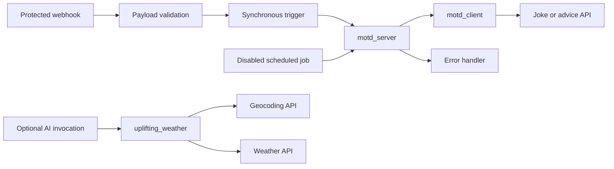

# Build your first PolyAPI workflow in Python

This tutorial takes you from a fresh clone to a protected message-of-the-day
webhook, then adds an optional AI weather function in the same workflow.
Run shell commands from the repository root. Examples use Bash; the root
[README](../../../README.md#quick-start) includes Fish and PowerShell setup.

## 1. Understand the pieces

PolyAPI hosts integration resources in a **tenant** and an **environment**.
The generated Python SDK exposes the resources your key can access.
Start with [how Poly fits together](https://docs.polyapi.io/concepts/mental_model.html)
and the [resource guide](https://docs.polyapi.io/concepts/choosing-a-resource.html).

| Primitive | Purpose | Where you see it here |
| --- | --- | --- |
| API function | A trained outbound HTTP call exposed through the SDK | Joke, advice, geocoding, and weather APIs trained from OpenAPI specs |
| [Client function](https://docs.polyapi.io/generated_sdks/client_functions.html) | Reusable Python that runs in its caller | `motd_client` chooses an API and validates its response |
| [Server function](https://docs.polyapi.io/functions/server_functions.html) | Python hosted by PolyAPI | `motd_server` validates input and orchestrates the greeting |
| Schema | A reusable data contract | The webhook payload schema and generated function types |
| [Webhook](https://docs.polyapi.io/webhooks/managing-webhooks.html) | An inbound HTTP endpoint | The protected message-of-the-day URL |
| Trigger | Connects an event to a server function | The webhook trigger and error trigger |
| Job | Calls a server function on a schedule | The bundled job starts disabled |
| [Vari](https://docs.polyapi.io/vari_variables/code.html) | Configuration and secrets with controlled visibility | The joke host is SECRET; the advice host is OBSCURED |
| Tabi | Managed structured tables | Supported by Flow; this sample does not need a table |
| AI function | A prompt, tools, and an output contract | Optional `uplifting_weather` uses the two weather APIs |
| Canopy / PolyUI | The platform UI and hosted applications | Inspect resources, enter secrets, and view executions |
| GraphQL subscription | A long-lived event source | Supported by Flow; no subscription is needed for this tutorial |

API, client, and server functions have different execution boundaries. In
particular, a client function runs in the caller; it is not another remote
server invocation. See the [Python SDK guide](https://docs.polyapi.io/generated_sdks/python.html).

## 2. Find the source and resources

```text
workflows/src/sample_workflow/
  README.md                 This onboarding tutorial
  OVERVIEW.md               Runtime contracts and operational details
  client/                   Message selection and payload validation
  server/                   Webhook/job entrypoint and error handler
  artefacts/
    specs/motd/             Joke and advice OpenAPI specifications
    specs/weather/          Geocoding and weather OpenAPI specifications
    schemas/                Webhook input contract
    vari/                   Configuration declarations, not real secrets
    webhooks/               Endpoint and security configuration
    triggers/               Event-to-function connections
    jobs/                   Disabled scheduled invocation
    ai-functions/           Optional weather AI definition
  tests/                    Offline tests and opt-in live tests
```

The shared functions live in `workflows/src/utilities/common/`. Flow itself and
its tests live in `cli/`. The directory spelling is `artefacts`.
Python files carry inline `polyConfig`; JSON files describe other resources.
The **context and name**, not the local filename, identify a deployed resource.



## 3. Install and select an environment

Install [uv](https://docs.astral.sh/uv/) and make the tools listed in the root
[prerequisites](../../../README.md#local-development-checks) available to your
terminal. Python remains pinned to **3.12.12** and the native SDK to
**0.3.21.dev1**.

```bash
source cli/shell/flow.bash
flow setup
```

Setup creates and activates `.venv`, runs the SDK's setup prompts, verifies
the key with `/whoami`, and shows the tenant and environment names. Confirm
the suggested `workflows/dev.env` or `workflows/prod.env`; an unclear name
defaults to dev. Setup offers to create a missing file from the placeholder
example and optionally save the shell helper. It also configures VS Code.

An environment is a separate resource catalog inside a tenant. A filename
such as `dev.env` is only a local convention: the URL and key select the actual
target. Renaming a file never changes the key's permissions or environment.
Read [managing environments](https://docs.polyapi.io/environments/ui.html).

For a different target, rerun `flow setup` with its instance URL and key,
check the displayed identity, and confirm the desired file. Any instance can
be used, including dev, EU1, NA1, or NA2. The relevant settings are:

| Setting | Meaning |
| --- | --- |
| `POLY_API_BASE_URL` | The selected instance URL |
| `POLY_API_KEY` | A key for the intended tenant/environment |
| `TARGET_ENV_ID` | The verified environment ID; Flow rejects a mismatch |
| `POLY_EXEC_API_KEY` | The execution identity for deployed server functions |
| `POLYAPI_NAMESPACE` | The context root this project owns, initially `example` |

Keep actual values only in ignored local files. Do not commit them, paste them
into commands, or reuse a development execution key in production. Setup clears
the saved execution key when the target changes. Add the correct key locally
before deploying server functions.

Before training or deploying, use a development target and a branch based on
`develop`. For a fresh template-generated repository with only `main`:

```bash
git switch -c develop
git switch -c feature/my-workflow
```

If `develop` already exists locally, use `git switch develop` instead of creating
it; if it exists only on the remote, use `git switch --track origin/develop`.
Then create your feature branch from it. Use your project's feature-branch naming
convention. The example configuration binds `develop` and its descendants to
`workflows/dev.env`. Staying on `main`, or branching directly from it, triggers
production safeguards even when the selected file is `workflows/dev.env`.
`flow setup` selects the environment; it does not change Git branches.

To explicitly use a configured file for a single command:

```bash
ENVPATH=workflows/dev.env uv run --locked python cli/flow.py push --paths sample_workflow --dry-run
ENVPATH=workflows/prod.env uv run --locked python cli/flow.py push --paths sample_workflow --dry-run
```

Production branch, identity, execution-key and OTP checks still apply. See the
[Flow reference](../../../cli/README.md) before a production deployment.

## 4. Choose your context and run offline checks

The sample uses `example.sample_workflow`; shared utilities use
`example.utilities` (with separate configuration and diagnostic contexts). Replace `example` consistently in source SDK calls,
`polyConfig`, JSON references, names/slugs, and the selected env file. Follow
the root [customization guide](../../../README.md) and
[conventions](../../../CONVENTIONS.md). Changing only `POLYAPI_NAMESPACE` does
not rewrite source or move existing remote resources.

```bash
rg -n '\bexample\b' workflows/src designs/examples
make check
```

Checks run without credentials and do not deploy. Keep `example` in the commands
below only if it is still your chosen namespace.

## 5. Train the message APIs

Training converts an OpenAPI specification into PolyAPI catalog functions.
The Python tooling handles translation, optional AI metadata enrichment,
training, and SDK regeneration; no Node tooling or `train_oas.sh` is needed.
See [OpenAPI training](https://docs.polyapi.io/api_functions/openapi.html).

Start with an offline preview, then train the two public APIs:

```bash
ENVPATH=workflows/dev.env uv run --locked python -m cli.operations train-openapi workflows/src/sample_workflow/artefacts/specs/motd --context example.sample_workflow --disable-ai --dry-run
ENVPATH=workflows/dev.env uv run --locked python -m cli.operations train-openapi workflows/src/sample_workflow/artefacts/specs/motd --context example.sample_workflow --disable-ai
```

`--disable-ai` keeps the operation names used by this sample and avoids needing
an AI provider for the first walkthrough. It does not disable AI functions.
Saved `.poly.json` models are reviewable. To retrain one, use `train-model`;
existing files are protected unless `--overwrite-model` is explicit. AI
enrichment remains available when the flag is omitted; review renamed calls
before changing the sample. See [training options](../../../cli/README.md#openapi-training-cleanup-and-logs).

## 6. Preview and deploy the message workflow

Deploy the core resources first; leave AI out until its provider is configured:

```bash
flow push-dynamic --paths sample_workflow --types functions,variables,schemas,webhooks,triggers,jobs --dry-run
flow push-dynamic --paths sample_workflow --types functions,variables,schemas,webhooks,triggers,jobs
```

Read the plan and target before confirming. `push-dynamic` includes affected
server consumers of changed client functions. Its scope can extend beyond the
initial path. A successful dry run is not proof of deployed behavior.

In Canopy, set `example.sample_workflow.joke_api_config` to the SECRET object
`{"hostUrl":"https://official-joke-api.appspot.com"}`. The advice configuration
starts with its public host as OBSCURED. These public hosts demonstrate two
different secrecy behaviors; no upstream API account is required.
Use the UI to enter the object-valued secret. See the
[runtime overview](OVERVIEW.md#training-and-configuration) for injection details.

The client passes the SECRET injection reference directly into the generated
API call. It never reads or caches that secret. Do not replace this with direct
HTTP execution or pass the reference through another client function.

## 7. Invoke and inspect the result

Find the deployed webhook in Canopy and copy its actual URL, including the
environment subdomain. Send a POST with your authorized PolyAPI key and this
JSON body using the UI or your API client:

```json
{"name":"Reader","mood":"wise"}
```

Expect HTTP 200 with a greeting and advice. Try `funny` for a joke. Invalid
input should be rejected; check the runtime overview for handled error shapes.
Inspect the function execution/logs in Canopy if it fails. Never paste keys or
raw secret-bearing logs into a report.

For the existing opt-in live test, set `POLY_TEST_WEBHOOK_URL` locally to that
exact URL, then run:

```bash
RUN_POLY_INTEGRATION=true uv run --locked --env-file workflows/dev.env pytest workflows/src/sample_workflow/tests/test_motd_integration.py
```

The scheduled job is deliberately disabled. Enable it in the target only when
you want recurring execution and have verified the direct workflow first.

## 8. Add the optional weather AI

The weather function is another resource in **this same sample workflow**.
It has a separate invocation so the basic webhook works without an AI provider.
Follow [weather setup](OVERVIEW.md#weather-ai) to configure the tenant provider,
train `artefacts/specs/weather`, deploy `uplifting_weather`, and run its opt-in
test. The weather APIs need no signup or trial for evaluation; AI execution
still requires a configured provider and may incur charges.

If upgrading an existing checkout, the former `example.sample_ai_fx` resources
are not renamed remotely by moving files. Train and deploy the weather resources
in `example.sample_workflow`, verify them, then separately review cleanup of the
old context. This change does not delete existing platform resources.

## 9. Build your own workflow

Create a sibling workflow with only the directories it needs. Define the input
contract, write self-contained client/server functions, declare resources and
portable references, and add focused tests. Keep generated SDK calls aligned
with the deployed context/name. Never locally import a neighboring deployable
function: Flow uploads each file independently.

Run `make check`, review a scoped dry run, deploy to development, and verify
the actual result before promoting. Use the [Flow reference](../../../cli/README.md)
for resource selection, resume, generation, and cleanup. Cleanup is destructive:
preview the exact disposable context with `delete-content` and review it before
adding `--apply`; never delete shared tenant/provider configuration.

Continue with the [official tutorials](https://docs.polyapi.io/tutorials/index.html)
and [documentation home](https://docs.polyapi.io/).
