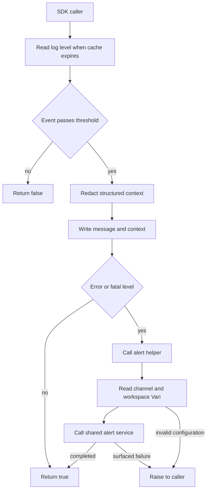
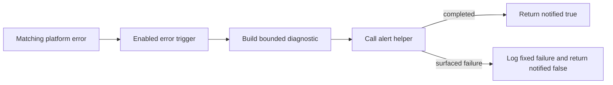

# Shared logging and alerts

Learn how to produce useful logs, filter noise, redact named fields, and route
failures to an alert service. Start with an `info` message, inspect its output,
then follow the optional alert path.

Complete [Getting started](../../../../README.md#getting-started) first. The
[message-of-the-day lesson](../../sample_workflow/OVERVIEW.md) introduces the SDK
and deployment concepts used here. Run commands from the repository root.

Coding-agent skills are optional. Kickstart installs them, and manual checkouts
already include core Python guidance. See the
[skills guide](../../../../docs/SETUP.md#agent-skills) if you want more.

## The pieces

| Resource | What it teaches | Source |
| --- | --- | --- |
| `example.utilities.log` | A reusable client helper with level filtering and structured context | [Logger](client/log_cfx.py) |
| Log-level Vari | Runtime configuration with a bounded cache | [Log level](artefacts/vari/log_level_vari.json) |
| `example.utilities.slack.send_alert` | A client helper that calls another deployed service | [Alert helper](client/send_alert_cfx.py) |
| Slack configuration | Deployment placeholders become runtime Vari values | [Channel](artefacts/vari/channel_id_vari.json), [workspace](artefacts/vari/workspace_type_vari.json) |
| `example.diagnostics.services.error_alerts` | A best-effort server boundary for platform error events | [Handler](server/error_alerts_sfx.py), [trigger](artefacts/triggers/error_alerts_trigger.json) |

The context root must match `POLYAPI_NAMESPACE`. For example,
`POLYAPI_NAMESPACE=my_project` means `my_project.utilities`,
`vari.my_project.configurations`, and corresponding trigger destinations.
Kickstart updates these pre-included utilities and the copied guide's examples.
For a fresh manual checkout, run the local namespace-alignment step in
[manual setup](../../../../docs/SETUP.md#configure-a-deployment-target-manually)
to update the starter code, artefacts, and examples together. Changing the
environment variable alone is insufficient. For already-customized or deployed
projects, follow [ownership and references](../../../../docs/CONVENTIONS.md#ownership-and-references).
The examples in this copy use `example`; confirm that this matches your selected file.

## Run the logging lesson

### 1. Check configuration and dependencies

Select the file configured during setup once per terminal session:

```bash
export ENVPATH=workflows/dev.env
```

Python Flow resolves relative paths from the project root, so include
`workflows/`. Use your selected file if different. The SDK example below loads
the same file explicitly with `uv --env-file "$ENVPATH"`.

For the complete utility deployment, set these values in the selected ignored
Flow environment file:

| Setting | Example or requirement |
| --- | --- |
| `LOG_LEVEL` | `info` for this lesson |
| `SLACK_CHANNEL_ID` | A destination accessible to the selected workspace's alerting app |
| `SLACK_WORKSPACE_TYPE` | `community` for PolyAPI Community or `internal` for the PolyAPI workspace |

These are substituted into three NONE Vari artefacts during deployment. Runtime
helpers read those Vari resources; they do not read your local environment file.
The target also needs access to `OOB.polyapi.internal.alerting.sendAlertToPoly`.
This dependency supports the specified PolyAPI Slack workspaces; it is not a
connector to an arbitrary Slack workspace.

If that shared service is unavailable, the focused mocked tests still let you
study the logger and alert contracts without sending messages:

```bash
uv run --locked pytest workflows/src/utilities/common/tests/test_utilities.py
```

**Checkpoint:** local tests pass without credentials. Confirm your target's
configuration and shared-service access before the full deployment below.

### 2. Deploy the utilities

```bash
uv run --locked python cli/flow.py push-dynamic --paths utilities/common --dry-run
uv run --locked python cli/flow.py push-dynamic --paths utilities/common
```

Review the target and expanded dependency plan before the real push. The common
error trigger starts enabled. `push-dynamic` also rebuilds local consumers of
changed clients; its plan can extend beyond the initial utility scope.

**Checkpoint:** the three configuration variables and three functions exist in
your namespace, the SDK is regenerated, and the log-level Vari is `info`.
Neither a dry run nor successful deployment proves Slack delivery.

### 3. Log, redact, and filter

This direct SDK example reads the runtime log-level Vari. Confirm the native SDK
connection and generated bindings point to your intended environment; direct
calls do not enforce Flow's `TARGET_ENV_ID`. The SDK uses saved setup or canonical
`POLY_API_BASE_URL` / `POLY_API_KEY` overrides, not Flow's other aliases.
Substitute your chosen namespace in the calls if different from `example`.

```bash
uv run --locked --env-file "$ENVPATH" python - <<'PY'
import asyncio
from polyapi import poly

async def main():
    logged = await poly.example.utilities.log(
        "info", "tutorial", "order_received",
        {"orderId": "demo-123", "api_key": "placeholder-not-a-secret"},
    )
    filtered = await poly.example.utilities.log(
        "debug", "tutorial", "detail_for_debugging", {"orderId": "demo-123"},
    )
    print({"logged": logged, "filtered": filtered})

asyncio.run(main())
PY
```

With the log level set to `info`, expect:

```text
[info][tutorial] order_received | context={"orderId": "demo-123", "api_key": "[REDACTED]"}
{'logged': True, 'filtered': False}
```

**Checkpoint:** the `info` message appears, the named sensitive field is redacted,
and the `debug` message is absent. These levels do not send an alert. Client
functions run in their caller's process: this example writes to your terminal;
a server function calling the same logger writes to that server's logs.

## Try it yourself

- Put a placeholder token inside a nested object and confirm it is redacted while
  useful fields remain. Use synthetic values only.
- Set the log-level Vari to `debug` through Canopy, then start the example in a
  new process. Both calls should log. An existing process may retain its cached
  setting for up to 60 seconds.
- Set the threshold to `silent` and rerun. Both calls should return `False`, with
  no log output or logger-triggered alerts. Restore your desired level afterward.
- Read the alert-failure tests. Explain why the global handler catches delivery
  failures while direct `log("error", ...)` callers can still receive an error.

## Flow: log



[The logger](client/log_cfx.py) accepts `debug`, `info`, `warn`, `error`, or `fatal`
events. Its NONE Vari holds a threshold including `silent`; NONE is a secrecy
level, not a logging level. The threshold is cached for 60 seconds. Invalid
configuration retains the current level; failed refreshes fall back to `debug`.
The default context is read-only.

Context redaction recursively replaces recognized key names, including API keys,
authorization, app keys, client secrets, execution IDs, passwords, secrets,
tokens, and correlation headers. Matching ignores case, underscores, and hyphens.
Opaque variable references are redacted; circular and deeply nested values are
bounded. Message strings are not scrubbed: use fixed event names and safe text.

Only unfiltered `error` and `fatal` entries call
[send_alert](client/send_alert_cfx.py). It reads the exact Slack Vari, validates
`community` / `internal`, logs start/success with a shared correlation ID, and
awaits the generated internal alert function. Message previews are not logged;
PagerDuty levels are explicitly empty. A successful helper returns `True` after
the service call completes, but the service can handle Slack errors internally.
Verify the actual destination to establish delivery.

### Flow: error_alerts



[The global handler](server/error_alerts_sfx.py) sends a fixed failure message,
validated function names/contexts, and an integer HTTP status when available.
It does not forward arbitrary messages, stacks, URLs, headers, bodies, or nested
error data. It calls the alert helper even when logging is `silent` and catches
surfaced notification failures to avoid an error-handler loop.

The [trigger](artefacts/triggers/error_alerts_trigger.json) filters platform errors
using the owned root in `errorHandler.path`; it is not a subscription to every
error in the tenant. Actual event matching needs runtime verification. These
utilities use configuration Vari and no Tabi state.

## Verification and troubleshooting

Run the focused tests from step 1 after changes. They mock configuration reads
and alert delivery, checking thresholds, redaction, argument mapping, and handler
behavior. They do not prove access to the shared function or arrival in Slack.

| Symptom | Check |
| --- | --- |
| Generated utility missing | Confirm the namespace, deployment, and generated SDK all use the same target. |
| Log-level change seems ignored | Allow the 60-second cache to expire or start a fresh caller process. |
| Secret-looking text appears | Redaction covers recognized context keys, not arbitrary message text. |
| Alert configuration rejected | Check nonempty channel ID and an allowed workspace type in runtime Vari. |
| Helper returns success but Slack is empty | Confirm app access, workspace, and actual destination; completion is not proof of delivery. |
| Global handler returns `notified: false` | A notification failure was caught; inspect the fixed diagnostic without exposing payloads. |

A Slack user ID can request a direct message from the app. A self-DM ID does not
prove the app can access that conversation. Live alert exercises should use an
agreed test destination and synthetic content.

## Migration and operations reference

The `log_settings` context avoids the SDK's generated `logging` import. Existing
projects using `configurations.logging.log_level` should deploy the new Vari and
logger, regenerate SDK bindings, and rebuild server consumers with `push-dynamic`.
Keep the old Vari until consumers migrate; scoped pushes do not delete it.
`LOG_LEVEL` remains the environment setting. Existing environment files must add
`SLACK_WORKSPACE_TYPE` before redeploying the complete utilities.

OpenAPI training, scoped cleanup, and function logs live in
[cli/operations.py](../../../../cli/operations.py), sharing Flow's target, OTP, and
production safeguards. See the [CLI reference](../../../../cli/README.md) for
commands. These are operator actions; the runtime helpers do not invoke them.
